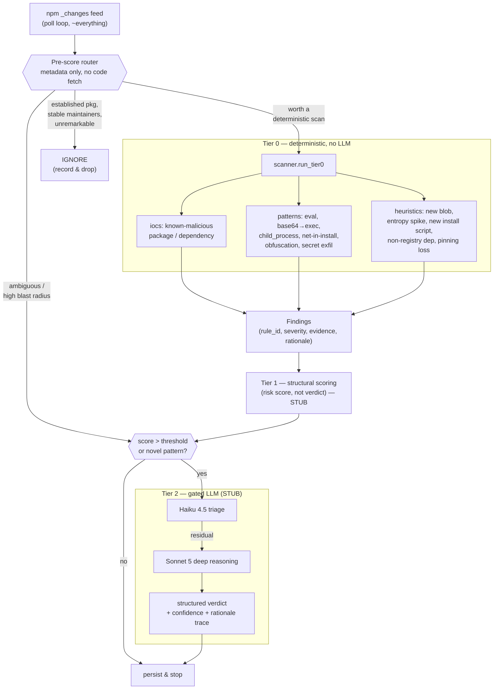
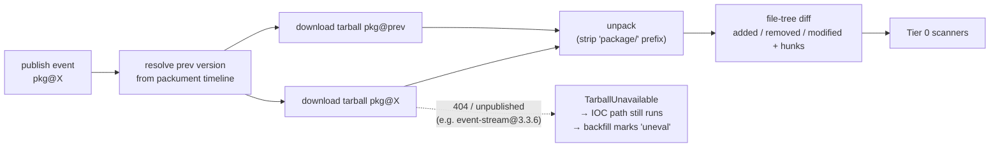
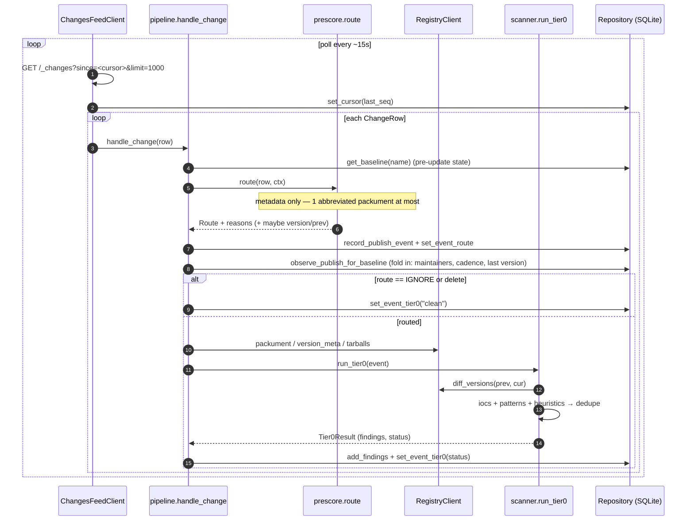
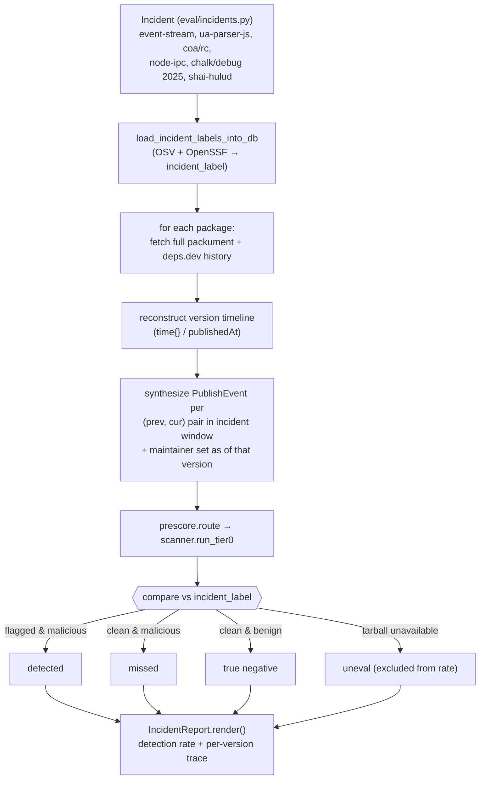
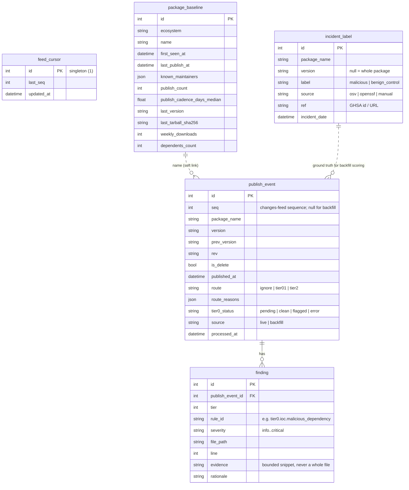
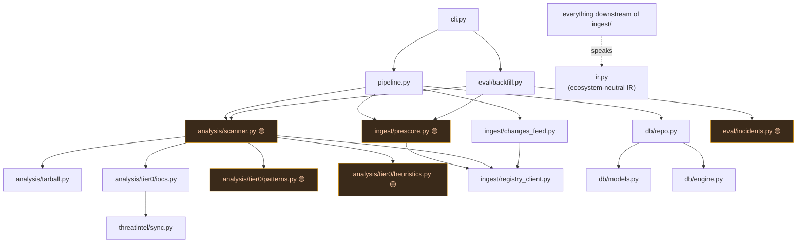

# Kitsunox — Architecture

> AI-assisted detection of software supply chain attacks in open source package
> registries, starting with npm. Capstone project — academic, not production.

Related: [[Build Status]] · [[TODO]]

---

## 1. Problem & approach

npm supply chain attacks (compromised maintainer accounts, malicious `postinstall`
scripts, dependency confusion / typosquatting, dormant packages suddenly republishing)
are usually caught **reactively** — after damage, via advisory databases.

Kitsunox does **continuous, ecosystem-wide monitoring** of npm publishes, with a
**token-efficient tiered funnel** so that expensive LLM reasoning is spent only on
genuinely ambiguous cases. Cheap deterministic checks eliminate the overwhelming
majority of events first.

---

## 2. The tiered filtering funnel



**Design rule:** never run an LLM on every event. Tier 0/1 are pure code. Tier 2 sees
only the specific diff hunks / script content that triggered escalation — never whole
files or repos.

| Stage | LLM? | Runs on | Output | Status |
|---|---|---|---|---|
| Pre-score | no | ~all events | route + reasons | 🟡 fallback only ([[TODO#1. prescore.route\|prescore]]) |
| **Tier 0** | no | routed events | findings | 🟢 iocs done; 🟡 patterns/heuristics ([[TODO#2. tier0/patterns.scan\|patterns]], [[TODO#3. tier0/heuristics.check\|heuristics]]) |
| Tier 1 | no | Tier 0 output | risk score | 🔴 stub |
| Tier 2 | yes | score > threshold | verdict | 🔴 stub |

---

## 3. Unit of analysis

**Per publish** (decided). npm publishes can diverge from git — what's in the registry is
not guaranteed to match the tagged commit — so the tarball is the source of truth:



---

## 4. Live pipeline (the `listen` command)



**Crash recovery:** the cursor is persisted after every page, so a restart resumes from
`feed_cursor.last_seq` with no reprocessing. Row handling is idempotent on
`(package, version, rev, source)`.

---

## 5. Historical backfill (the `backfill` command) — evaluation

This is how the project gets graded. It doesn't wait for live data.



Final deliverable numbers:
1. **Detection rate** on known incidents (backfill)
2. **False-positive rate** on a random control sample of benign live publishes *(Tier 1 / eval phase — not built)*
3. **Token/cost accounting**: how much volume was filtered before Tier 2

---

## 6. Persistent store

SQLite now (single file, hand it to a reviewer), all access behind
`db/repo.Repository` + SQLAlchemy 2.0 so a Postgres swap is one module. Alembic
migrations from day one.



`package_baseline` **is** the "small threat-intel database the system builds over time" —
it's not a stateless scanner.

---

## 7. Module layout & dependencies



🟡 = author-owned stub (see [[TODO]]). Everything else is implemented.

**The Postgres seam:** only `db/*` imports SQLAlchemy. `Repository` returns plain
dataclasses (`BaselineView`, `EventView`, `LabelView`), never ORM objects.

**The multi-ecosystem seam:** `ir.py` is deliberately npm-agnostic. npm terms are mapped
*in* at `ingest/registry_client.py`; PyPI/crates would add a sibling client, nothing else.

---

## 8. External services

| Service | Endpoint | Used for | Notes |
|---|---|---|---|
| npm replication | `GET replicate.npmjs.com/registry/_changes?since=&limit=` | the firehose | **poll only** since May 2025 — no `feed=continuous`, no `include_docs`. Header `npm-replication-opt-in: true`. `limit` max 10000. |
| npm replication root | `GET replicate.npmjs.com/registry/` | `update_seq` to start "near now" | |
| npm registry | `GET registry.npmjs.org/<pkg>` | full packument: `versions`, `time`, `maintainers`, per-version `dist`/`scripts`/`_npmUser` | abbreviated variant (`Accept: application/vnd.npm.install-v1+json`) is smaller but has **no `time`** |
| npm downloads | `GET api.npmjs.org/downloads/point/last-week/<pkg>` | popularity signal | |
| deps.dev | `GET api.deps.dev/v3/systems/npm/packages/<pkg>` | dependents count, per-version `publishedAt` | |
| OSV.dev | `POST api.osv.dev/v1/query` `{package:{ecosystem:"npm",name}}` | live IOC fallback + malicious-version ground truth | malware advisories flagged via `MAL-*` id or CWE-506 family |
| OSV bulk export | `osv-vulnerabilities.storage.googleapis.com/npm/all.zip` | offline mirror (all npm advisories, malware filtered) | |
| OpenSSF Malicious Packages | `codeload.github.com/ossf/malicious-packages/tar.gz/refs/heads/main` | offline mirror of confirmed-malicious npm packages | pulled as **tarball, not git clone** — repo has Windows-invalid paths |

`intel-sync` streams the two bulk sources into a single `data/intel-mirror/index.json`
(~440k hits, ~2 s to load). `data/` is git-ignored.

---

## 9. Configuration

Env vars (prefix `KITSUNOX_`) or `.env` — see `.env.example`. Key ones:

| Var | Default | Meaning |
|---|---|---|
| `KITSUNOX_DB_URL` | `sqlite:///data/kitsunox.db` | |
| `KITSUNOX_FEED_START` | `now` | `now` \| `now-<N>` (N seq back) \| `0` (full history) — only used when the cursor is empty |
| `KITSUNOX_POLL_INTERVAL_SECONDS` | `15` | sleep when caught up |
| `KITSUNOX_CHANGES_PAGE_LIMIT` | `1000` | `_changes` page size |

---

## 10. CLI

```
kitsunox db-init                       # alembic upgrade head
kitsunox intel-sync                    # rebuild data/intel-mirror/index.json
kitsunox listen [--once] [--max-events N]
kitsunox scan <pkg>@<version>          # ad-hoc Tier 0, no feed
kitsunox backfill [--incident <key>]   # historical evaluation  [needs TODO #5, #6]
```
