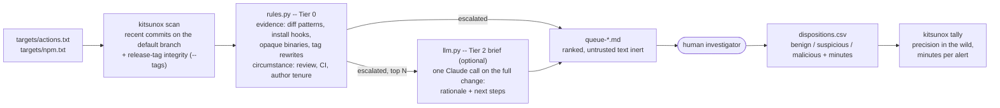

# Kitsunox — Semester Plan

Capstone project, MSc Cybersecurity Engineering. **Budget: 10 weeks, ~5 hours/week (≈50
hours total).** Must produce a working, demonstrable result with real evaluation numbers
— not a production product.

---

## 1. Problem & pivot

Original framing was ecosystem-wide npm registry monitoring (continuous `_changes` feed,
growing baseline DB). That's infrastructure-heavy and doesn't fit a 50-hour budget, and
registry-level detection is already well covered by existing tools (Socket, Phylum,
OpenSSF Scorecard).

**New framing: source-level supply chain attacks, detected from git commits and pull requests.** These attacks abuse repository control and automated tooling directly —
malicious code hidden in commits, PRs that bypass review, tampered CI/build scripts —
and are comparatively under-tooled. `xz-utils` (CVE-2024-3094) is the canonical example: a backdoor built up over ~2 years of legitimate-looking commits by a trusted maintainer, hidden in binary test fixtures and triggered via a tampered `configure`/`m4` build script.

## 2. Non-goals (explicit, to keep scope bounded)

- **No automated verdict and no investigating agent.** The pipeline ends in a human
  investigator. An agentic Tier 3 was built, measured and removed -- see §4.

- No continuous/ecosystem-wide monitoring, no long-running feed consumer.
- No live GitHub Action / webhook front-end **this pass** (stretch goal only if weeks
  remain — see §7).
- No database, migrations, or persistent baseline. Inputs are two fixed lists (incidents,
  control repos); outputs are report files. A flat JSON cache for fetched API responses
  is the most persistence this needs.
- No multi-ecosystem support, no npm-registry-specific code.
- **No package-artifact scanning.** Published tarballs are a different unit of
  analysis with no commit, author or review metadata, and they are already well
  covered (GuardDog, OSSGadget, Socket). External package corpora are used once, as
  a source of findings about rule coverage (§7), never as the evaluation target.

## 3. Architecture

**Unit of analysis:** a *change* — either a merged pull request (commits + diff + review/
approval metadata) or a direct push to the default branch (commit + diff, no PR). Both
matter: `colors.js`'s infinite-loop sabotage and most of the `xz-utils` backdoor were
committed directly by a trusted maintainer, no PR involved.

**Scope:** GitHub Actions and npm source repositories. Both are human-readable
(JavaScript, TypeScript, shell, YAML), which is where the measurements say an LLM brief
is most trustworthy, and where an added binary is unusual enough to escalate alone.



The ground-truth incidents and the held-out control corpus (§5, §6) evaluate Tier 0
offline with `kitsunox evaluate`; the hunt is how the tool is used in the wild.

### Module layout

```
kitsunox/
  fetch.py       # GitHub REST API client: commits, PRs, author tenure, release tags,
                 #   default-branch reachability; fresh listings for hunting
  model.py       # Change, FileDiff, Finding dataclasses
  rules.py       # Tier 0: evidence + circumstance rules, capability scoring, tag integrity
  llm.py         # Tier 2: one Claude call -> analyst brief with next steps
  incidents.py   # the 5 ground-truth incidents
  evaluate.py    # offline evaluation; hunting, triage queue, disposition log, tally
  cli.py         # evaluate | check | scan | tally
```

Deliberately ~7 files. No ORM, no CLI subcommand sprawl. If it needs more structure later, add it when the need is concrete, not in advance.

### Auth / access

A GitHub personal access token (public-repo read scope is enough) raises the API rate
limit from 60/hr to 5000/hr — required at this volume. Store as `GITHUB_TOKEN`.

Responses are cached to `.cache/gh/`, keyed by URL and parameters, so re-runs during
tuning cost nothing. One cache-design note that matters at repo scale: author history
is fetched once per `(repo, author)` and tenure computed locally. Keying it on the
change timestamp instead — as the first implementation did — means re-fetching the
same history for every commit by that author, which is the difference between a
feasible whole-repo scan and an infeasible one.

## 4. Detection design

### Grounding

Rule categories are an operationalisation of Ladisa et al., *Taxonomy of Attacks on
Open-Source Software Supply Chains* (IEEE S&P 2023) — 107 attack vectors linked to 94
real incidents and 33 safeguards. Citing it matters: it turns "regexes I invented" into
"an implementation of a published taxonomy", and it defines the project's scope
precisely. The five incidents sit in the **AV-300** (inject into sources) and **AV-400**
(inject during build) subtrees; registry-level tools such as GuardDog cover **AV-500**
(distribute a malicious version), which is a different problem.

| Incident | Attack vector |
|---|---|
| `event-stream` | AV-800 Become a Maintainer → AV-302 Contribute as Maintainer |
| `xz-utils` | AV-302 + AV-400 Inject During the Build of Legitimate Package |
| `reviewdog/action-setup` | AV-602 Take-over Legitimate Account → AV-401 Run Malicious Build |
| `tj-actions/changed-files` | AV-303 Tamper with Version Control System + AV-309 Hide in Generated/Compiled/Minified Code |
| `colors.js` | AV-302 Contribute as Maintainer |

### Tier 0 — deterministic, runs on every fetched change

Findings split into two families, and **the split is the core design decision**:

- **Evidence** (`content.*`, `combo.*`) — what the change *contains*.
- **Circumstance** (`context.*`) — where it landed, who merged it, whether CI passed.

Only evidence can cross the escalation threshold. Circumstance corroborates, sharpens
ranking, and gives Tier 2 context, but never accuses on its own.

That is an empirical finding, not an aesthetic one. Measured on the control sample,
circumstance rules fire constantly — CI touched 31%, self-merged 20%, no approvals 18%,
failing checks 11% — so any three stack past any useful threshold on ordinary
maintenance. `psf/requests#6968`, a Makefile tweak merged by its own author, escalated
that way with no payload evidence at all. Splitting the score eliminated that entire
false-positive class without weakening a single real detection.

**Evidence rules** (what the change contains):

| Signal | Why it matters |
|---|---|
| long base64 literal added | how reviewdog and tj-actions carried payloads past diff review; elevated inside build scripts, CI and generated bundles |
| shell/eval execution primitive | *not* elevated inside CI config — a workflow's whole job is to run shell, and treating it as notable produced two false positives |
| paste/tunnel host or routable IP | gist, pastebin, ngrok, and the OOB-interaction domains (burpcollaborator, canarytokens, `oast.*`, webhook.site) where a DNS lookup is often the entire payload |
| credential/memory/environment access | `NPM_TOKEN`, `.npmrc`, `/proc/*/mem` — the target of CI secret theft |
| npm lifecycle install hook (`preinstall`/`install`/`postinstall`/`prepare`) | graded by what the hook *does* — reaching the network, carrying an encoded payload, silencing its own output, collecting host identity. Declaring one is `low`: node-gyp builds declare them too |
| binary file added, elevated under a test-fixture path | the xz backdoor shipped as rigged `.xz`/`.lzma` test data, where a corrupt-looking blob is unremarkable |
| loop with no reachable termination | the entirety of the colors.js sabotage: no payload, just a hang |
| dependency added | fires on 93% of malicious packages *and* 13% of benign changes — near-zero information alone, kept only as a combination ingredient |

**Circumstance rules** (how it landed): CI or build-script path touched, generated
artifact modified, PR self-merged, zero approving reviews, merged with failing checks,
first-time contributor touching build tooling, and author tenure (below).

### Author tenure — the event-stream signal

`event-stream` is the one incident whose diff contains nothing malicious: the payload
lived in the `flatmap-stream` dependency, so the only git-visible trace is *who* added
it and *how recently they arrived*. This is AV-800, "Become a Maintainer", made
measurable.

GitHub exposes no record of when commit rights were granted, so the proxy is the
author's first commit in that repo:

| Author | Tenure at the change | Prior commits |
|---|---|---|
| event-stream `right9ctrl` | **5 days** | **9** |
| event-stream `dominictarr` (owner) | 7 years | 248 |
| xz `JiaT75` | 2 years | 431 |
| colors.js `Marak` (owner) | 11 years | 78 |

Tenure alone is useless — 56% of benign PR authors are under 30 days, because popular
repositories run on first-time contributors. What discriminates is **tenure × privilege**:
a new contributor opening a *reviewed pull request* is ordinary open source; a
five-day-old maintainer *pushing directly to the default branch* is event-stream. The
combination of a new maintainer, a direct push, and a new dependency fired on 1 of 45
benign changes where each half alone fired on 56% and 13%.

xz is deliberately **not** caught this way: 756 days and 431 commits in. No tenure
threshold catches the long con, and that limitation belongs in the write-up rather than
being engineered around.

### Capability scoring

Named pairs (`COMBOS`) handle the highest-confidence co-occurrences — an encoded blob in
an install script is the reviewdog compromise exactly. Beyond those, each evidence rule
maps to a capability — obfuscation, execution, network, collection, concealment,
sabotage, delivery — and distinct capabilities co-occurring earn a bonus (2 → +2,
3 → +6, 4 → +10, capped). One capability is ordinary; several in one change is an attack
chain. This is the correlation principle GuardDog uses (a capability *and* a threat
indicator in the same file), rather than an invention.

`delivery` alone scores zero, for the reason in the table above.

### Opaque binaries

In a JavaScript, TypeScript or Actions repository an executable, native module or archive
has no reason to appear unexplained, and none of it can be reviewed as a diff. Opaque
binaries -- no extension, `.node`, `.wasm`, `.so/.dll/.dylib`, archives and compressed
data including `.xz` and `.lzma` -- escalate on their own anywhere. Images, fonts and media
get a separate `content.asset_added` rule outside the capability model: as `binary_added`
a logo counted as concealment, so a logo, a new dependency and one subprocess call scored
1 + 1 + 1 plus a three-category bonus of 6 and escalated an ordinary CLI change.

### Release-tag integrity -- the Actions attack surface

Actions consumers pin a tag (`uses: owner/action@v4`), so their CI runs whatever the tag
points at, not what is on the default branch. Both Actions incidents exploited this:
reviewdog's malicious commit was on no branch at all, and tj-actions rewrote every version
tag to one commit (Ladisa **AV-303**, Tamper with Version Control System). A
default-branch scan could see neither. The 5/5 evaluation never exposed the gap because
`incidents.py` hands the pipeline the malicious SHAs directly.

| Rule | Severity | Signal |
|---|---|---|
| `tag.version_collapse` | critical | release tags from different `major.minor` lines on one commit |
| `tag.moved` | critical | a full release tag changed target since the last hunt's snapshot |
| `tag.on_no_branch` | high | a floating or moved tag points at a commit on no branch at all |

They use a `tag.` prefix, not `context.`: a rewritten release tag is direct evidence, not a
circumstance, and must escalate alone. Floating tags (`v1`, `v1.2`) sharing a commit with
their release is normal and excluded; patch-only collisions count as republishes.
Verified on live data: `on_any_branch` returns False for reviewdog's `f0d342` (on none
of its 10 branches) and True for its branch head, and a tag hunt raises nothing on its
restored tags. The first version checked only the default branch and raised 18 alerts on
the first Actions hunt -- 10 with no other evidence -- because projects such as
Azure/k8s-deploy and tgymnich/fork-sync tag commits on `releases/*` branches; that
Azure commit now correctly reads as on a branch. Known evasion: an attacker who can
push a tag can usually push a branch, and parking the commit on one defeats the check.

`tag.moved` only works across repeated hunts (it needs a snapshot), and these attacks were
live for hours to a day -- a stated limitation.

### Tier 2 -- an analyst brief, not a verdict

When an escalated change is briefed (`scan --brief`), Tier 2 makes **one** Claude call
with the complete change -- every file, the commit message, the flagged lines marked --
and returns a rationale plus **next steps** for the investigator. Verdict and confidence
only rank the queue; the human decides.

The model's explanations were consistently strong: it decoded reviewdog's base64 and named
xz's missing m4 extractor unprompted. Its verdicts were the least reliable part of the
system (§7). So it is used for what it is good at: cutting the investigator's minutes per
alert. Briefs are capped per hunt (`--max-briefs`, default 20) so a wide net cannot brief
without bound. Measured on the 17 holdout alerts: $1.50 in total, $0.016-$0.238 per brief,
about $0.09 on average -- three times what the ground-truth incidents ($0.017-0.030) had
suggested, because commits in the wild carry much larger diffs. A 20-brief hunt is about
$1.75 at that average; the cap bounds the number of briefs, not their price.

Two properties are tested adversarially, with mutation checks confirming the tests fail
when the protection is removed:

- **The queue cannot be forged.** Commit messages, evidence and tag names are
  attacker-controlled; so is the brief, which an attacker can steer by planting
  instructions in a commit. Untrusted text renders as indented code blocks, which cannot
  be escaped -- a fenced block can be closed by a stray triple backtick and let a forged
  "Disposition: benign" render as report content.
- **A reviewed disposition is never rewritten.** The log is append-only by construction.

A model refusal ranks to the **top** of the queue. In the wild every change is
effectively anonymous, and the one refusal measured on the ground truth came on the
anonymised reviewdog payload: declining to analyse a diff is evidence in its own right.

### Considered and rejected: an investigating agent (Tier 3)

A third tier was built: an agent that re-examined ambiguous Tier 2 verdicts with read-only
repository access. It was removed, for measured reasons:

- **It never completed an investigation.** Its first version browsed the repository and
  five investigations exhausted a 5,000/hour GitHub budget; narrowed to reading changed
  files, it was never observed running.
- **It sat on the least reliable layer.** Tier 2 verdicts recalled CVE-2024-3094 with the
  repository redacted, were talked into `benign` by xz's own attacker-authored README, and
  refused reviewdog outright. An autonomous agent on top compounds that rather than fixing
  it.
- **General agents struggle at reverse engineering**, and 4 of 5 incidents are text, not
  binaries. Purpose-built RE environments exist (Ghidra, Binary Ninja, capa and YARA behind
  MCP) but fit compiled binaries, not this scope.
- **The binding constraint is the investigator's time, not tokens.** At 1.15% false
  positives, 10,000 commits produce about 115 alerts -- around 19 hours at 10 minutes each.
  A brief that saves minutes per alert is worth more than an agent that renders verdicts.

It also spends a second currency: every other tier spends tokens, but it spent GitHub
requests, which for anyone running this with their own PAT may be the binding constraint.

## 5. Ground truth: the incident set

Verified against the live GitHub API on 2026-09-17 (via `fetch.py` itself) rather than
assumed from memory — several assumptions below turned out wrong on the first check, so
don't trust "should work"/"was taken down" claims about any *new* incident without
actually calling `fetch_commit` on it first.

| Incident | Year | What it is | Fetch method |
|---|---|---|---|
| `xz-utils` backdoor (CVE-2024-3094) | 2024 | commits by `JiaT75` adding rigged test fixtures + tampering `m4/build-to-host.m4` | **live** `fetch_commit` against `tukaani-project/xz` — the repo was *not* actually taken down |
| `event-stream` / `flatmap-stream` | 2018 | `right9ctrl`'s commit adding the malicious `flatmap-stream` dependency to `package.json` | **live** `fetch_commit` against `dominictarr/event-stream` |
| `reviewdog/action-setup` compromise (CVE-2025-30154) | 2025 | `install.sh` commit injecting a base64-encoded Runner-memory-scraping payload; first stage of the attack chain that led into tj-actions | **live** `fetch_commit` against `reviewdog/action-setup` — reachable by its abbreviated SHA `f0d342` even though it's off every branch/tag |
| `tj-actions/changed-files` compromise (CVE-2025-30066) | 2025 | tag-rewrite to a commit that dumped CI secrets via a curl-to-gist memory scraper (same technique as reviewdog, one step further downstream) | **hardcoded** — the commit object itself is gone from the repo and every mirror checked, but recovered **byte-exact anyway**: a legitimate fork (`trmlabs/changed-files`) cloned the repo at the malicious commit and reverted it; diffing that revert reproduces the original diff exactly. Stored in `kitsunox/fixtures/tj_actions_changed_files_2025.json`. |
| `colors.js` sabotage | 2022 | Marak Squires' direct-push commit adding an unterminated `for (...; i < Infinity; ...)` loop that DoS'd every consuming app | **live** `fetch_commit` against `Marak/colors.js` — replaces the originally-planned `node-ipc` "peacenotwar" incident, whose commit was fully scrubbed (repo has zero commits from all of 2022) and whose behavior we could only reconstruct, not recover byte-exact |

`ua-parser-js` was dropped entirely (not swapped): its malicious versions were published
straight to npm via a hijacked account token — no git commit was ever involved, so a
git/PR-focused tool has nothing to point at for it.

Five is enough for a meaningful detection-rate number without turning "collect ground
truth" into its own multi-week project. Add more only if time remains after Tier 0 works
on these.

## 6. Control sample

**All five incidents are direct pushes, not pull requests.** A control sample made only
of merged PRs therefore measures false positives on a population that structurally cannot
trigger the push-based rules. The sample has two halves:

- **Merged pull requests** — review metadata, approvals, author association.
- **Direct pushes to the default branch** — the population the incidents actually come
  from.

### Held-out design

An early 81-change sample (psf/requests, pallets/flask, expressjs/express, axios/axios)
was used to *tune* three rules; two regression tests are derived from its false
positives. It is therefore **training data**, and any false-positive rate measured on it
is circular. It is retained as a regression suite, not as a result.

The reported figure comes from a **held-out corpus of ~750 changes across 25
repositories in 10 languages** — Python, TypeScript, JavaScript, Go, Rust, Java, Ruby,
PHP, C and C++ — none of which were touched during tuning. Language diversity is
deliberate: rules keyed on `package.json`, `dist/` bundles and npm idioms had only ever
been tested against Python and JavaScript web libraries, so any ecosystem-specific false
positives will surface in repositories we never looked at.

### Contamination

Commits from an incident's own repository **cannot** be used as negatives. Excluding the
single malicious SHA does not decontaminate a repository whose maintainer was
compromised for a period. Measured directly: of 34 "benign" pushes drawn from the
incident repos, 5 escalated — and all 5 were attack-adjacent, including `5999958d`, the
`event-stream` 3.3.6 release commit that shipped the malicious dependency. An incident's
repository is excluded from the control sample entirely.

## 7. Evaluation & deliverable

### Measured results

Tier 0 only, `kitsunox evaluate` (reports under `reports/`):

| | Result |
|---|---|
| Detection | **5/5** incidents |
| False positives, held out | **8/695 = 1.15%** across 25 repos, 10 languages (449 PRs + 246 direct pushes) |
| False positives, after fixing those 8 | 0/695 — **in-sample, not a claim**; see below |
| Escalation rate | **5/700 = 0.71%** of changes reach Tier 2 |
| Tier 2 cost | ~$0.02–0.03 per escalated change; ~**$0.13 to review 700 changes** |

**The honest false-positive figure is 1.15%, not 0%.** Both fixes were derived from those
eight failures, so the corpus stopped being held out the moment it was tuned against —
the same circularity that invalidated the earlier 0/81. Asserting 0% requires a fresh
sample from untouched repositories. What 0/695 does show is that the fixes remove their
target classes without costing detection.

Every one of the eight false positives appeared in a language **absent from the tuning
set** — `while (true)` in nlohmann/json (C++), a zlib version string read as an IP in
curl (C). A Python/JavaScript-only control would have reported a misleadingly clean
number. That is the argument for a multi-language control sample, and it is evidence
rather than assertion.

The escalation rate is the tiered-funnel claim made concrete: Tier 0 disposes of 99.3% of
changes for nothing, and the expensive tier runs on the rest.

- **Detection rate** — of the 5 incidents, how many Tier 0 escalates and Tier 2 confirms.
- **False-positive rate** — on the held-out corpus, reported separately for merged PRs
  and direct pushes, since the rule populations differ.
- **Cost/volume accounting** — changes seen, changes escalated, tokens and dollars spent.
  This is the evidence for the tiered funnel's efficiency claim; it should not be
  asserted without the number.
- **Walkthroughs** — a handful of "here is the exact commit and here is what fired",
  with xz-utils as the headline.

### In the wild

`kitsunox scan --targets ... --queue DIR` writes a ranked queue and appends to
`DIR/dispositions.csv`; the investigator records a disposition and minutes per alert;
`kitsunox tally` reports precision in the wild, the share worth a look, and median minutes
per alert. That makes manual review a measurement rather than effort -- and it still
yields a result if no attack is confirmed, which is the likeliest real outcome.

**Calibrate, then measure.** The held-out 1.15% was measured on zero Actions repositories,
so the first hunts in the new scope were run as calibration, and every rule change they
prompted is traced to its evidence. Two calibration hunts, 40 repositories each:

| Hunt | Alerts | What it exposed | Change |
|---|---|---|---|
| Actions | 40 | `GITHUB_TOKEN` named in docs, tests and `${{ secrets.* }}`: sole cause of 14 | naming a token is low weight; reading a credential store or process memory still escalates |
| | | tags on `releases/*` branches: sole cause of 10 | `tag.on_no_branch` -- a commit on *no* branch, which is what reviewdog's was |
| | | path assembly evaded the `/proc` match | `/proc` plus `mem|maps|environ` anywhere on the line |
| | | two commits from one PR shared a key | keys follow source, not PR association |
| npm | 25 | squash merges mislabelled as direct pushes: 9 | the newcomer rule excludes PR-associated commits |
| | | repo founders on day 0 of their own project: 11 | the author must arrive in an *established* repo (180 days) |
| | | arrival measured from `created_at` put xz's attacker on day 0 | arrival from the earliest commit: 0 becomes 5,164 days |

The Actions calibration set fell from 40 alerts to 11 after its changes. That is
**in-sample** -- it says the changes remove what they target, not how the tool performs.

**The measurement** is a hunt over holdout targets drawn from the same population (same
queries and filters) but sharing no repository and no owner with the calibration lists:
`targets/holdout-actions.txt` and `targets/holdout-npm.txt`, reviewed in
`triage/measurement/`. Its precision, from `kitsunox tally`, is the reportable
in-the-wild result.

The first Actions false-positive class observed was **installer actions that pipe a
remote script to `sh`** -- downloading and running a tool is a `setup-*` action's whole
purpose, and also exactly the shape of a supply-chain attack. It was predicted to be
committed `dist/` bundles; it was not.

### Stated limitations

These belong in the write-up as findings, not as defects to engineer around:

1. **The long con is out of reach.** xz's author had 756 days and 431 commits of
   legitimate history. No tenure threshold distinguishes that from a real maintainer; xz
   is caught by *what the commit contains*, not by who wrote it.
2. **Diff-level analysis cannot see a malicious dependency.** `event-stream`'s commit is
   a legitimate-looking feature. The tool escalates it on author trust, which flags *the
   author*, not *the change* — it fires on essentially every commit that author made in
   the window. That is defensible for Tier 2 triage and indefensible as a verdict, and
   the distinction must not be blurred.
3. **Sample size.** Five incidents is enough for a meaningful demonstration and too few
   for a confidence interval.

4. **Tier 2 verdicts are contaminated by recognition, and the ablation is mandatory.**
   All five incidents are famous, heavily-documented public attacks that are certainly in
   the model's training data. In the first Tier 2 run it cited **CVE-2024-3094 by number**
   and named `right9ctrl` and the exfiltration gist unprompted. Re-running with the
   repository and author fields withheld (`--anonymize`) moves detection from **5/5 to
   4/5**:

   | Incident | Identified | Anonymised |
   |---|---|---|
   | xz-utils | malicious (0.72) | **benign (0.80)** |
   | event-stream | malicious (0.90) | malicious (0.85) |
   | reviewdog | malicious (0.99) | malicious (0.99) |
   | tj-actions | malicious (0.99) | malicious (0.99) |
   | colors.js | malicious (0.97) | malicious (0.93) |

   Four verdicts are robust — reviewdog and tj-actions hold at 0.99, because they turn on
   decoded payload behaviour rather than on the name of the repository. **Any LLM-tier
   result on publicly-known incidents must be reported alongside this ablation, or it is
   a memory test rather than a measurement.** The control is partial and must be described
   as such: file paths and diff contents remain, because they are the evidence.

5. **A single change is the wrong unit of analysis for a staged attack — demonstrated,
   not asserted.** The anonymised xz verdict did not fail through non-recognition; the
   model still identified the fixtures and reasoned *against* the attack: "nothing in the
   flagged set touches build scripts, CI configuration, or any code that would extract and
   execute the fixture contents." That is **correct**. The commit adds opaque test
   fixtures; the code that extracts and runs them lived in `m4/build-to-host.m4`, which
   shipped only in the release tarball and never entered git. Tier 0 fires on a real
   signal and Tier 2 correctly declines to infer intent from it. Both behave properly —
   the unit of analysis is what fails.

   Stated generally: **diff-scoped detection cannot establish intent when an attack's
   payload and its trigger are separated across commits or artifacts.** Detecting xz
   would require reasoning over a commit *series* plus the published tarball, which is a
   different and much larger problem than the one scoped here.
6. **External benchmarking revealed a blind spot our own ground truth could not.**
   Against the ASE 2026 npm benchmark (6,420 malicious / 7,288 benign, expert-reviewed),
   baseline detection of the content rules was 19.1%. The dominant miss was npm lifecycle
   install hooks: 67% of malicious packages declare one, and *none of the five git-level
   incidents do*, so no amount of work on our own corpus would have surfaced it. Adding
   install-hook rules more than doubled detection on that corpus and costs nothing on
   GitHub data. The general lesson — a five-incident ground truth cannot reveal the gaps
   in its own coverage — is worth more than the number. Package-artifact scanning is
   otherwise out of scope (§2); those corpora are not commits, and the adapter written to
   read them was removed once the finding was banked.

## 8. Schedule (10 weeks × 5h ≈ 50h)

| Weeks | Hours | Work | Checkpoint | Status |
|---|---|---|---|---|
| 1-2 | 10 | `fetch.py` + `model.py` + `incidents.py`; verify each incident against the live API before assuming it needs a fixture | correct diffs/metadata for all 5 incidents | **done** |
| 3-4 | 10 | `rules.py` (Tier 0) | fires on ≥3 of the 5 incidents | **done** — 5/5 |
| 5 | 5 | Held-out control corpus; inspect false positives, tune thresholds | FP rate measured on data not used for tuning | **done** -- 1.15% (8/695) |
| 6-7 | 10 | `llm.py` (Tier 2), wired to Tier 0's escalation; recognition ablation | escalated cases get a brief | **done** -- analyst brief; ablation 5/5 to 4/5; Tier 3 built and rejected |
| 8 | 5 | `evaluate.py` + `cli.py`; tag integrity; hunting, triage queue, disposition log | detection + FP + cost numbers in hand; a hunt produces a queue | **done** |
| 9 | 5 | **Hunt in the wild** over `targets/`; review the queue; record dispositions | `kitsunox tally` gives precision in the wild and minutes per alert | in progress |
| 10 | 5 | Write-up and slides | presentation-ready | |

### §7a — Whole-repository scan (stretch)

`--repo owner/name` with the user's own PAT, walking a repository's history and ranking
commits by score rather than flagging them.

Two constraints, both measured. The commit list endpoint returns no diffs, so a naive
scan costs one request per commit — 3,119 for `tukaani-project/xz`, ~6,200 for larger
repos. `GET /commits?path=` narrows this sharply where the signal is path-shaped
(`tests/files` cuts xz to 49 commits, and the malicious commit survives the filter), at
the cost of only finding attacks in paths anticipated in advance — so it is a `--fast`
mode, not the default.

More importantly, base rates change the claim. One malicious commit among 3,119 means
even a 1% false-positive rate buries it under 31 false alarms. The output must therefore
**rank, not flag**, and the honest headline is *"pointed at xz-utils, JiaT75's commit
ranks #N of 3,119"* — a stronger result than a detection rate on a curated set, and the
precision-at-realistic-base-rates discussion is a genuine contribution rather than a
weakness.

## 9. Risks

| Risk | Mitigation |
|---|---|
| An incident's malicious commit gets scrubbed from live history (happened to `tj-actions` and the original `node-ipc` pick) | Check a "clone-then-revert" fork first (attacker activity often gets forked/reverted within hours) before assuming a lossy reconstruction is the only option; if truly unrecoverable byte-exact, swap the incident rather than fabricate evidence. |
| GitHub API rate limits / pagination surprises | Authenticated PAT (5000/hr) is plenty for this volume; cache fetched responses to a flat JSON file so re-runs during tuning don't re-hit the API. |
| Tier 0 tuning becomes a time sink (too many false positives on the control sample) | Time-box it to week 5's 5 hours; ship whatever threshold is reasonable and note the tradeoff in the write-up rather than chasing zero FPs. |
| Diff too large for a bounded LLM call | Send only the hunks Tier 0 actually flagged, not the full diff; truncate with a note if still too large. |
| Running low on time by week 8 | Sections 5-6 (ground truth + control sample) are fixed-size by design — cutting scope later means fewer incidents/repos, not new infrastructure, so a partial result is still coherent. |
