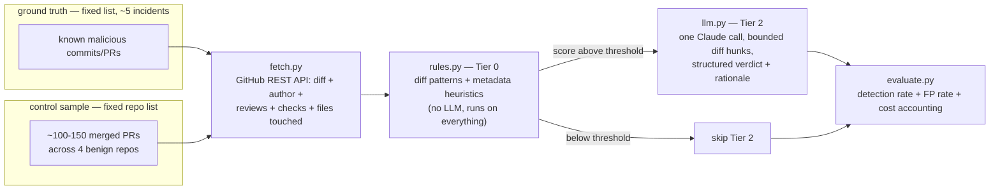

# Kitsunox — Semester Plan

Capstone project, MSc Cybersecurity Engineering. **Budget: 10 weeks, ~5 hours/week (≈50
hours total).** Must produce a working, demonstrable result with real evaluation numbers
— not a production product.

---

## 1. Problem & pivot

Original framing was ecosystem-wide npm registry monitoring (continuous `_changes` feed,
growing baseline DB). That's infrastructure-heavy and doesn't fit a 50-hour budget, and
registry-level detection is already well covered by existing tools (Socket, Phylum,
OpenSSF Scorecard).

**New framing: source-level supply chain attacks, detected from git commits and pull requests.** These attacks abuse repository control and automated tooling directly —
malicious code hidden in commits, PRs that bypass review, tampered CI/build scripts —
and are comparatively under-tooled. `xz-utils` (CVE-2024-3094) is the canonical example: a backdoor built up over ~2 years of legitimate-looking commits by a trusted maintainer, hidden in binary test fixtures and triggered via a tampered `configure`/`m4` build script.

## 2. Non-goals (explicit, to keep scope bounded)

- No continuous/ecosystem-wide monitoring, no long-running feed consumer.
- No live GitHub Action / webhook front-end **this pass** (stretch goal only if weeks
  remain — see §7).
- No database, migrations, or persistent baseline. Inputs are two fixed lists (incidents,
  control repos); outputs are report files. A flat JSON cache for fetched API responses
  is the most persistence this needs.
- No multi-ecosystem support, no npm-registry-specific code.

## 3. Architecture

**Unit of analysis:** a *change* — either a merged pull request (commits + diff + review/
approval metadata) or a direct push to the default branch (commit + diff, no PR). Both
matter: `colors.js`'s infinite-loop sabotage and most of the `xz-utils` backdoor were
committed directly by a trusted maintainer, no PR involved.



### Module layout

```
kitsunox/
  fetch.py       # GitHub REST API client: fetch_commit(), fetch_merged_prs()
  model.py       # Change, FileDiff dataclasses
  rules.py       # Tier 0: pattern scan (diff) + metadata heuristics
  llm.py         # Tier 2: one Claude call -> structured verdict
  incidents.py   # the ~5 ground-truth incidents, hardcoded
  evaluate.py    # runs the pipeline over incidents + control sample -> report
  cli.py
```

Deliberately ~7 files. No ORM, no CLI subcommand sprawl. If it needs more structure later, add it when the need is concrete, not in advance.

### Auth / access

A GitHub personal access token (public-repo read scope is enough) raises the API rate
limit from 60/hr to 5000/hr — required for pulling ~150 PRs' worth of diffs+metadata
without babysitting rate limits. Store as `GITHUB_TOKEN` env var.

## 4. Detection design

### Tier 0 — deterministic, runs on every fetched change

| Signal | Why it matters |
|---|---|
| `.github/workflows/*` touched | CI/Action tampering — how `tj-actions/changed-files` was compromised (tag rewritten to point at credential-dumping code) |
| build/install script touched (`Makefile`, `configure`, `setup.py`, `binding.gyp`, `m4/*`) | how the `xz-utils` payload was triggered at build time |
| binary file added, or a file added under a "test fixture"-looking path with high entropy | xz hid its backdoor in a corrupted-looking test file |
| merged PR with zero approving reviews, or merged by the PR's own author | bypassed review |
| direct push to the default branch by an account that rarely pushes directly | account-compromise-shaped |
| first-time contributor whose PR touches CI/build files | `event-stream`-shaped trust abuse (new contributor granted trust, then adds a malicious dependency) |
| classic code patterns in diff hunks: `eval`/`exec`, base64→exec, obfuscated identifiers, secret exfiltration | carried over from the original npm-registry design, still directly relevant |

Each rule emits a `Finding` (rule id, severity, file, line, bounded evidence snippet,
rationale) and contributes to a per-change score.

### Tier 2 — minimal LLM escalation

When Tier 0's score crosses a threshold, make **one** Claude call with the specific
flagged diff hunks + the Tier 0 reasons (never the whole diff/repo). Output: a structured
verdict (`malicious` / `suspicious` / `benign`), a confidence, and a short rationale.
Single model to start (no Haiku→Sonnet cascade) — that complexity can come later if the
budget allows; a correct minimal version beats an elaborate broken one.

## 5. Ground truth: the incident set

Verified against the live GitHub API on 2026-09-17 (via `fetch.py` itself) rather than
assumed from memory — several assumptions below turned out wrong on the first check, so
don't trust "should work"/"was taken down" claims about any *new* incident without
actually calling `fetch_commit` on it first.

| Incident | Year | What it is | Fetch method |
|---|---|---|---|
| `xz-utils` backdoor (CVE-2024-3094) | 2024 | commits by `JiaT75` adding rigged test fixtures + tampering `m4/build-to-host.m4` | **live** `fetch_commit` against `tukaani-project/xz` — the repo was *not* actually taken down |
| `event-stream` / `flatmap-stream` | 2018 | `right9ctrl`'s commit adding the malicious `flatmap-stream` dependency to `package.json` | **live** `fetch_commit` against `dominictarr/event-stream` |
| `reviewdog/action-setup` compromise (CVE-2025-30154) | 2025 | `install.sh` commit injecting a base64-encoded Runner-memory-scraping payload; first stage of the attack chain that led into tj-actions | **live** `fetch_commit` against `reviewdog/action-setup` — reachable by its abbreviated SHA `f0d342` even though it's off every branch/tag |
| `tj-actions/changed-files` compromise (CVE-2025-30066) | 2025 | tag-rewrite to a commit that dumped CI secrets via a curl-to-gist memory scraper (same technique as reviewdog, one step further downstream) | **hardcoded** — the commit object itself is gone from the repo and every mirror checked, but recovered **byte-exact anyway**: a legitimate fork (`trmlabs/changed-files`) cloned the repo at the malicious commit and reverted it; diffing that revert reproduces the original diff exactly. Stored in `kitsunox/fixtures/tj_actions_changed_files_2025.json`. |
| `colors.js` sabotage | 2022 | Marak Squires' direct-push commit adding an unterminated `for (...; i < Infinity; ...)` loop that DoS'd every consuming app | **live** `fetch_commit` against `Marak/colors.js` — replaces the originally-planned `node-ipc` "peacenotwar" incident, whose commit was fully scrubbed (repo has zero commits from all of 2022) and whose behavior we could only reconstruct, not recover byte-exact |

`ua-parser-js` was dropped entirely (not swapped): its malicious versions were published
straight to npm via a hijacked account token — no git commit was ever involved, so a
git/PR-focused tool has nothing to point at for it.

Five is enough for a meaningful detection-rate number without turning "collect ground
truth" into its own multi-week project. Add more only if time remains after Tier 0 works
on these.

## 6. Control sample

Four active, high-external-PR-volume repos, **none** connected to a known supply chain
incident (keeps ground truth uncontaminated): `psf/requests`, `pallets/flask`,
`expressjs/express`, `axios/axios`. Pull ~25-40 recent merged PRs from each (~100-150
total) as the benign baseline for false-positive measurement.

## 7. Evaluation & deliverable

- **Detection rate**: of the 5 incidents, how many does Tier 0 (+ Tier 2 where escalated)
  flag as malicious/suspicious.
- **False-positive rate**: of the ~100-150 control PRs, how many get flagged.
- **Cost/volume accounting**: how many changes were seen, how many escalated to Tier 2,
  and the resulting token/dollar cost — demonstrates the tiered-funnel's efficiency claim.
- Presentation output: these three numbers plus a handful of concrete "here's the exact
  commit and here's what fired" walkthroughs (xz-utils is the headline example).

**Stretch, only if weeks remain:** a thin GitHub Action / webhook front-end reusing the
same `rules.py`/`llm.py` core, that comments on a live incoming PR. Explicitly out of
scope for the graded deliverable; nice demo polish if time allows.

## 8. Schedule (10 weeks × 5h ≈ 50h)

| Weeks | Hours | Work | Checkpoint |
|---|---|---|---|
| 1-2 | 10 | `fetch.py` + `model.py`; verify each incident against the live API before assuming it needs a fixture | can print correct diffs/metadata for all 5 incidents |
| 3-4 | 10 | `rules.py` (Tier 0) | fires on ≥3 of the 5 incidents |
| 5 | 5 | Fetch + run control sample; inspect false positives, tune thresholds | FP rate measured and sane |
| 6-7 | 10 | `llm.py` (Tier 2), wired to Tier 0's escalation | escalated cases get a structured verdict |
| 8 | 5 | Full evaluation run across incidents + control sample | detection rate + FP rate + cost numbers in hand |
| 9-10 | 10 | Buffer, write-up, slides; stretch goal (§7) if ahead of schedule | presentation-ready |

## 9. Risks

| Risk | Mitigation |
|---|---|
| An incident's malicious commit gets scrubbed from live history (happened to `tj-actions` and the original `node-ipc` pick) | Check a "clone-then-revert" fork first (attacker activity often gets forked/reverted within hours) before assuming a lossy reconstruction is the only option; if truly unrecoverable byte-exact, swap the incident rather than fabricate evidence. |
| GitHub API rate limits / pagination surprises | Authenticated PAT (5000/hr) is plenty for this volume; cache fetched responses to a flat JSON file so re-runs during tuning don't re-hit the API. |
| Tier 0 tuning becomes a time sink (too many false positives on the control sample) | Time-box it to week 5's 5 hours; ship whatever threshold is reasonable and note the tradeoff in the write-up rather than chasing zero FPs. |
| Diff too large for a bounded LLM call | Send only the hunks Tier 0 actually flagged, not the full diff; truncate with a note if still too large. |
| Running low on time by week 8 | Sections 5-6 (ground truth + control sample) are fixed-size by design — cutting scope later means fewer incidents/repos, not new infrastructure, so a partial result is still coherent. |
