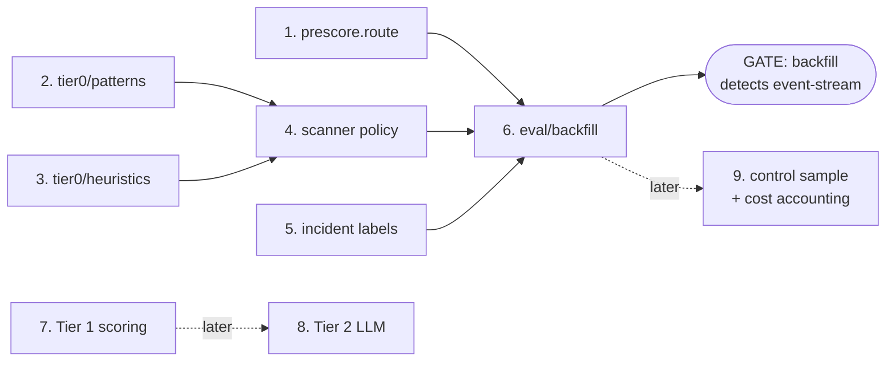
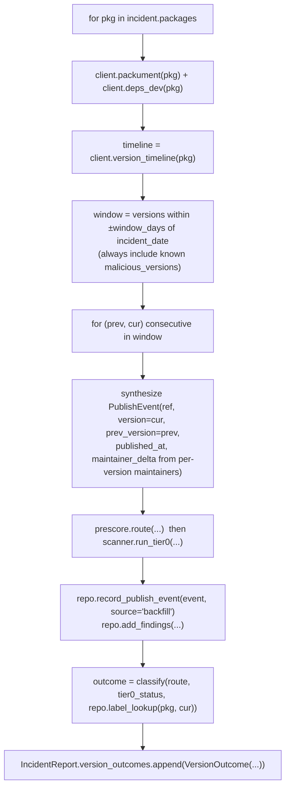

# Kitsunox — TODO (author-owned work)

Related: [[Architecture]] · [[Build Status]]

Everything below is scaffolded: typed signatures, docstrings with the full contract, and
`xfail(strict)` tests that pin expected behaviour. Implement the body, run the test, then
**delete the `xfail` marker** when it flips to passing.

```bash
uv run pytest -q            # unit
uv run pytest -q -m network # integration (npm + OSV)
uv run ruff check kitsunox tests
```

---

## Dependency order



Do **1–3** in any order (independent). Then **4**, then **5**, then **6** (the grade
gate). **7–9** are the next pass.

Suggested first move: **Task 2 (patterns)** — most self-contained, immediately testable,
and it's the heart of the detection story for the presentation.

---

## 1. prescore.route

**File:** `kitsunox/ingest/prescore.py` → `route(change_row, ctx) -> PrescoreResult`
**Test:** `tests/test_prescore.py` (`xfail(strict)`)

### Contract
Classify a `_changes` row into `Route.IGNORE | TIER01 | TIER2` using **metadata only —
no tarball, no code fetch**. Prefer a single abbreviated-packument request
(`ctx.client.packument(name, abbreviated=True)`); fall back to the full packument only
when you need `time` (abbreviated omits it).

`ctx` (`PrescoreContext`) gives you `ctx.repo` (a `Repository`) and `ctx.client`
(`RegistryClient`). `pipeline.py` folds the event into the baseline **after** you run, so
`ctx.repo.get_baseline(name)` is the **pre-update** state — compare against it.

Return `PrescoreResult(route, score, reasons, version, prev_version)`. Populating
`version`/`prev_version` lets the scanner skip a redundant lookup.

### Signals (each contributes to a score; threshold picks the bucket)
| Signal | Source | Weight |
|---|---|---|
| new package (`change_row.looks_new_package`) **with** an install script | packument `versions[latest].scripts` | TIER01 |
| maintainer set ≠ `baseline.known_maintainers` | packument `maintainers` / per-version `maintainers` | **high** → TIER01/TIER2 |
| dormant (`last_publish_at` older than N× `publish_cadence_days_median`) now publishing | baseline + packument `time` | TIER01 |
| version-jump anomaly (semver delta vs `unpackedSize` delta as a cheap diff proxy) | `dist.unpackedSize` | TIER01 |
| unpublish of a recent version (`change_row.deleted`) | row | TIER01 |
| high `weekly_downloads` / `dependents_count` | `client.weekly_downloads`, `client.deps_dev` (cache these — don't call per event if avoidable) | escalates any hit → TIER2 |
| established pkg, stable maintainers, nothing notable | — | IGNORE |

### Acceptance (`test_prescore.py`)
- established + stable maintainers + high `rev` → `IGNORE`
- new package (`rev = "1-..."`) with `postinstall` → `TIER01` or `TIER2`
- maintainer added since baseline → routed **and** a reason string contains "maintainer"
- `deleted=True` → routed

### Gotchas
- Must be **total** — never raise. Wrap network calls; on failure, default to `TIER01`
  (fail safe) with a reason.
- Popularity APIs are slow. Consider only fetching them when a cheaper signal already
  fired, or memoise per package for the process lifetime.
- Don't mutate the baseline here.

### Done when
`test_prescore.py` passes, marker deleted, and `kitsunox listen --once` shows varied
`route` values (not everything TIER01).

---

## 2. tier0/patterns.scan

**File:** `kitsunox/analysis/tier0/patterns.py` → `scan(file_diffs, version_meta) -> list[Finding]`
**Test:** `tests/test_tier0_patterns.py` (`xfail(strict)`)

### Contract
Signature scan over **added/modified text files only** (`FileDiff.hunks` holds the new
content / unified diff; `FileDiff.is_binary` files are skipped). Elevate severity for the
**install-script surface**: `version_meta.install_scripts` (`preinstall`/`install`/
`postinstall`) and the first-party files those scripts invoke (parse the script command
for a local `.js` path).

Pre-defined `rule_id` constants are in the module — keep them stable, the tests import
them.

### Signature families
| `rule_id` | Looks for |
|---|---|
| `RULE_DYNAMIC_EVAL` | `eval(` / `new Function(` on non-literal input |
| `RULE_BASE64_EXEC` | `Buffer.from(<lit>, 'base64')` / `atob(` feeding `eval`/`exec`/`Function` |
| `RULE_CHILD_PROCESS` | `require('child_process')`, `.exec`/`.execSync`/`.spawn` — **HIGH/CRITICAL inside an install script** |
| `RULE_INSTALL_NET` | `http`/`https`/`net`/`dns`, `fetch(`, `curl`/`wget` **inside an install script**, esp. to a raw IP or non-registry host |
| `RULE_OBFUSCATION` | `_0x[0-9a-f]{4,}` identifiers, single lines > ~500 chars, long `String.fromCharCode(...)` chains, high `\x`/`\u` density — where the rest of the file is readable |
| `RULE_SECRET_EXFIL` | `process.env` enumeration + outbound request; `.npmrc`, `~/.aws`, `/etc/passwd`, `NPM_TOKEN`, `GITHUB_TOKEN` |

### Each `Finding`
`tier=0`, `rule_id` (dotted, under `tier0.pattern.`), `Severity`, `file_path` + `line`
where locatable (line numbers are recoverable from the `+` lines in `hunks`), a **bounded**
`evidence` snippet (≤ `patterns.EVIDENCE_MAX_CHARS` — never a whole file), and a
plain-language `rationale`.

### Acceptance (`test_tier0_patterns.py`)
- `child_process` in a `postinstall`-referenced file → `RULE_CHILD_PROCESS`, correct
  `file_path`, severity ≥ HIGH, evidence bounded
- `eval(Buffer.from(..., 'base64'))` → `RULE_BASE64_EXEC`
- clean `module.exports = (a,b) => a+b` → `[]`
- empty diff list and binary-only diff → `[]` (no raise)

### Hints
- Start **regex-only**. `tree-sitter` + `tree-sitter-javascript` are optional deps
  (`uv sync --extra ast`) — only reach for them if regex false-positives on real install
  scripts get bad. A regex pass on `hunks` is enough for the acceptance bar.
- Keep each rule a small function `(_FileDiff, is_install_target: bool) -> list[Finding]`
  and map over the diffs.
- `minimatch`-style: to find the install-target files, take `install_scripts` values,
  regex out `\b[\w./-]+\.[cm]?js\b`, normalise, and match against `FileDiff.path`.

### Done when
`test_tier0_patterns.py` passes, marker deleted. Bonus: `kitsunox scan <a known
postinstall-abusing package>` lights up.

---

## 3. tier0/heuristics.check

**File:** `kitsunox/analysis/tier0/heuristics.py` → `check(file_diffs, prev_meta, cur_meta) -> list[Finding]`
**Test:** `tests/test_tier0_heuristics.py` (`xfail(strict)` on the `check`-dependent tests;
the `shannon_entropy` helper test already passes)

`prev_meta` is `None` on a package's first publish.

### Heuristics
| `rule_id` | Fires when |
|---|---|
| `RULE_NEW_BINARY` | an **added** `FileDiff` with `is_binary`, esp. `.node` / `.wasm` / executables / archives |
| `RULE_ENTROPY_SPIKE` | `shannon_entropy(added_or_modified_text) > ENTROPY_THRESHOLD` (packed payload) |
| `RULE_NEW_INSTALL_SCRIPT` | `cur_meta.has_install_script and not prev_meta.has_install_script` — **highest-value heuristic** |
| `RULE_NONREGISTRY_DEP` | a `cur_meta.dependencies` value is a `git+`, URL, `github:` or tarball spec (not a semver range) |
| `RULE_PINNING_LOSS` | a dep pinned/ranged in `prev_meta` widened to `*` / `latest` / a looser range in `cur_meta` |
| `RULE_SIZE_JUMP` | `cur_meta.unpacked_size` ≫ `prev_meta.unpacked_size` disproportionate to the semver bump |

### Acceptance (`test_tier0_heuristics.py`)
- `prev` no scripts, `cur` has `postinstall` → `RULE_NEW_INSTALL_SCRIPT`
- added `bin/helper.node` (binary) → `RULE_NEW_BINARY`
- dep = `git+https://…` → `RULE_NONREGISTRY_DEP`
- benign README-only modification → `[]`

### Hints
- `shannon_entropy(bytes) -> float` is provided (bits/byte; `bytes(range(256))` ≈ 8.0).
  You may need the file content — for a `MODIFIED` text diff you have `hunks`; for a full
  picture the scanner could pass the unpacked tree, but the acceptance tests only give
  you `FileDiff` + metas, so work from those.
- Semver comparison: add `packaging`-style parsing or a tiny `x.y.z` tuple split; you
  don't need full npm range semantics for the bar.

### Done when
`test_tier0_heuristics.py` passes, markers deleted.

---

## 4. scanner policy

**File:** `kitsunox/analysis/scanner.py` → `_decide_status(result)` and surrounding policy
**Test:** covered indirectly by `test_scanner_eventstream.py` (already green) and by
Task 6.

The wiring is done: `run_tier0` resolves prev version → diffs tarballs → runs
`iocs` + `patterns` + `heuristics` → dedupes → returns `Tier0Result`. What's left is
**judgement**:

- **`_decide_status`**: currently "any MEDIUM+ finding → `flagged`". Decide how LOW/INFO
  findings surface (feed a Tier 1 score? separate `review` status?). Decide what
  `tarball unavailable + partial + no findings` should be (`error` vs `clean`).
- **IOC short-circuit**: if `iocs` returns a CRITICAL direct hit, is the (expensive)
  tarball diff still worth doing? Probably skip it.
- **`resolve_prev_version`**: currently "nearest chronological predecessor". Consider
  "highest stable release before cur" so a prerelease→release diff isn't noise.
- **dependency extraction**: `run_tier0` passes `cur_meta.dependencies` to `iocs`.
  Add `optionalDependencies` / `bundleDependencies`? Skip `devDependencies` (not shipped).

### Done when
You're happy with the flag policy and `kitsunox scan` output on a handful of real
packages (both incident and benign) looks right. Add a focused test if you change
`_decide_status` semantics.

---

## 5. incident labels

**File:** `kitsunox/eval/incidents.py` → `load_incident_labels_into_db(repo) -> int`
**Test:** exercised by Task 6; also add a small direct test.

### Contract
Walk `INCIDENTS` (already seeded with the six incident keys, package names, dates, and
some GHSA ids). For each package:

1. If `incident.malicious_versions[pkg]` is populated, use it.
2. Otherwise resolve at runtime: `threatintel.osv_query_live(pkg)` → keep hits where
   `is_malware`, collect `.versions`.
3. Write each `(pkg, version, "malicious")` via
   `repo.add_incident_label(pkg, version, "malicious", source=..., ref=<GHSA/MAL id>,
   incident_date=...)`.
4. For `shai-hulud` (`packages=[]`), pull the affected npm package list from the mirror
   (`threatintel.load_index()` — filter by advisory id / date) rather than hardcoding.

Return the number of label rows written. `cli.py intel-sync` already calls this and
currently prints "not implemented — skipped".

### Gotchas
- Some malicious versions are **unpublished** and absent from OSV `versions` (only in
  `ranges`). Record them anyway from the incident's known list; the backfill marks
  unfetchable ones `uneval`.
- Keep `source` accurate (`osv` / `openssf` / `manual`) — the eval write-up will cite it.

---

## 6. eval/backfill — THE GRADE GATE

**File:** `kitsunox/eval/backfill.py` → `run_backfill(incident, *, client, repo, window_days) -> IncidentReport`
**Test:** `tests/test_backfill_eventstream.py` (`xfail(strict)`, `network`)

### Contract
The report dataclasses (`VersionOutcome`, `IncidentReport` with `.detection_rate` and
`.render()`) are done. Implement the reconstruction:



`classify`:
| ground truth | tier0_status | → outcome |
|---|---|---|
| malicious | flagged | `detected` |
| malicious | clean | `missed` |
| benign | clean | `true_negative` |
| any | (tarball unavailable) | `uneval` (excluded from `detection_rate`) |

Use `source="backfill"` on every persisted row so live stats stay clean (the schema's
unique constraint already includes `source`).

### Acceptance (`test_backfill_eventstream.py`)
- `event-stream@3.3.6` appears in the reconstructed timeline
- its `VersionOutcome.outcome == "detected"`
- `report.detection_rate` is `None` or `> 0`

`event-stream@3.3.6` is unpublished → its tarball 404s → detection **must** come from the
IOC path (`known_malicious_package` on the mirror, or `malicious_dependency` on
`flatmap-stream` if you can still read the dependency list). This already works via
`scanner.run_tier0` (see `test_scanner_eventstream.py`); your job is to drive it from the
timeline and score it.

### Then
Run `kitsunox backfill` for all six incidents. Record detected / missed / uneval per
version — that's the first data point for the evaluation section. No pass/fail bar yet.

### Done when
`test_backfill_eventstream.py` passes, marker deleted, and `kitsunox backfill --incident
event-stream` prints a report showing `detected` for 3.3.6.

---

## Later (next pass — not pass 1)

### 7. Tier 1 — structural risk scoring
`kitsunox/analysis/tier1/` (stub). Turn the cheap signals into a **calibrated score**
that gates Tier 2, rather than a hard flag:
- maintainer/account-change score
- publish-cadence deviation (proper model, not the running-mean estimate)
- version-jump anomaly
- dependency-graph diff (new transitive deps, git/tarball specs, pinning loss) as a score
Much of the raw signal is already in `package_baseline` and the pre-score reasons.

### 8. Tier 2 — gated LLM
`kitsunox/analysis/tier2/` (stub). `uv sync --extra llm` (Anthropic SDK).
- Haiku 4.5 first-pass triage → escalate residual to Sonnet 5
- **input = the specific diff hunks / script content that triggered escalation only** —
  never whole files
- structured output: `{verdict: malicious|suspicious|benign, confidence, rationale_trace}`
- per-call token accounting → aggregate for the "how much was filtered before Tier 2"
  number in the presentation
- use structured outputs (`output_config.format`) for the verdict schema

### 9. Evaluation completeness
- random **benign control sample** of live publishes over the accrual window → measure
  false-positive rate (expected by any technical reviewer)
- token/cost accounting table: events seen → routed → Tier 0 findings → Tier 2 calls → $
- presentation figures: detection rate (incidents) + FP rate (control) + funnel volumes

### 10. Ops niceties (optional)
- real work queue instead of synchronous `handle_change`
- `index.json` → SQLite table or prefix-sharded if memory bites
- secondary tarball source (Wayback / research mirrors) for unpublished malicious versions
