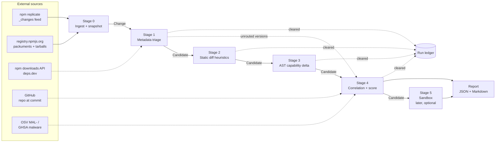

# Architecture

> **Status:** Stage 0 and its core pieces are implemented (2026-10-27): the data models
> (`core/models.py`), the `Ecosystem` contract (`core/interfaces.py`), the caching fetcher
> (`util/http.py`), the safe extractor (`util/archive.py`), and the npm adapter. The `Rule` and
> `Stage` contracts below are still proposals and get finalized with Stage 1.

## Pipeline



Each stage reads candidates and writes candidates. A stage never silently drops a change: items
it decides not to forward are written to the **run ledger** as *cleared at stage N*, with the
findings that were (or weren't) present. The ledger is what makes per-stage recall and
pass-through rates measurable.

## Determinism

The CLAUDE.md requirement ("same input + same rule versions → same output") is met by splitting
**fetching** from **analysis**:

1. **Snapshot.** Stage 0, and any later stage that fetches (tarballs, repo archives, OSV), does
   so through one caching HTTP client. Every response is stored content-addressed under `data/`,
   keyed by request, with the fetch time. A run is defined by a **snapshot manifest**: the change
   window, the `_changes` sequence range, and the hashes of every cached response it used.
2. **Analysis is pure.** Stages 1–4 are functions of (snapshot, rule versions, config). They
   never read the clock. "Now" is the run's explicit `as_of` timestamp.
3. **Replay.** `kitsunox run --snapshot <id>` re-runs analysis offline and must produce
   byte-identical JSON output. Tests enforce this.
4. **Stable ordering.** Every collection that reaches output is sorted by a defined key. Set
   iteration and dict insertion order don't count as defined.

## Data models (pydantic v2, in `core/`)

Sketch only. Field lists will be refined in Phase 2.

| Model | Purpose | Key fields |
|---|---|---|
| `PackageVersionRef` | Identifies one release | `ecosystem`, `name`, `version` |
| `PublishInfo` | How a version was published | `publisher`, `published_at`, `trusted_publisher` (bool + provider), `has_provenance`, `approver`, `git_head` |
| `Change` | Unit of work from Stage 0 | `new: PackageVersionRef`, `previous: PackageVersionRef \| None` (None ⇒ shape B), `new_publish`, `previous_publish`, `manifest_new`, `manifest_previous`, `repository_url`, `popularity` (weekly downloads, dependents), `artifact_refs` (tarball URL + integrity) |
| `Finding` | One rule firing | `rule_id`, `rule_version`, `severity`, `weight`, `title`, `explanation`, `evidence: list[Evidence]` |
| `Evidence` | Proof for a finding | `kind` (file-span, manifest-field, metadata), `path`, `line_start/end`, `snippet` (truncated, escaped), `before`/`after` |
| `Candidate` | A change moving through the pipeline | `change`, `findings`, `score`, `stage_history` (which stage passed/cleared it and why) |
| `RunManifest` | Reproducibility record | `run_id`, `as_of`, `window`, `snapshot_hash`, `rule_versions`, `config_hash`, tool version |

`Evidence.snippet` is always treated as untrusted text. Renderers must escape it, and it is never
interpreted. This matters again once an LLM stage exists.

### Schema versions

Every record written to disk on its own (`Change`, `SkippedPackage`, `RunManifest`, `Watchlist`,
`Snapshot`, cached `SnapshotEntry`) carries `schema_version`. Loaders check it before validating
and refuse other versions with a clear error (`util/schema.py`, `Persisted.load_json`). Any
incompatible model change bumps the version and gets a devlog entry. Old files are re-created,
or a migration is added if they are evaluation data worth keeping.

## Interfaces

```python
class Ecosystem(Protocol):  # implemented: core/interfaces.py
    name: str

    def feed_head(self) -> int: ...  # current change-feed position
    def list_changes(self, since: int, until: int) -> list[ChangeStub]: ...  # feed (since, until]
    def build_changes(self, stub: ChangeStub, window: Window) -> list[Change]: ...
    def fetch_artifact(self, artifact: ArtifactRef) -> ArtifactTree: ...  # verify + safe extract


class Rule(Protocol):  # implemented: core/rules.py; rules in rules/, ecosystems/<eco>/rules/
    id: str  # e.g. "npm.install-hook"
    version: int  # bump when behavior changes; recorded on every Finding

    # RuleContext = {as_of}; rules never read the clock, network or environment
    def evaluate(self, change: Change, ctx: RuleContext) -> Sequence[Finding]: ...


class Stage(Protocol):  # proposed: stages/ (Stage 1 is a function, stages/triage.py)
    id: StageId

    def run(self, candidates: Sequence[Candidate], ctx: StageContext) -> StageResult: ...

    # StageResult = forwarded candidates + cleared candidates (→ ledger)
```

- **Why the Ecosystem contract takes a feed range, not just a window:** the npm feed has no
  timestamps, so discovery has to work in feed positions. The publish-time window is applied
  afterwards, to each packument's per-version times. Other feeds (e.g. PyPI's serial-numbered
  changelog) fit the same shape. Details: [stages/ingest.md](stages/ingest.md).
- **`ArtifactTree`** is an extracted, read-only view of a tarball or repo archive. Extraction
  rejects absolute paths, `..`, symlinks/hardlinks that point outside the root, device files,
  and archives that exceed size / file-count / compression-ratio limits. Nothing is ever
  executed.
- **Forward vs. clear** is decided per stage by a documented policy: forward if any rule at or
  above a severity fired, or the cumulative score is past the stage threshold. Thresholds come
  from evaluation, not guesswork.
- **Scoring** (Stage 4) is the sum of `weight` over the rules that fired, each rule counted
  once at its largest weight (Stage 2 reports one finding per file), plus named *combination
  rules*. Every term in the score appears in the report. Stage 4 reports any version with a
  MEDIUM+ finding, or whose LOW findings add up to the report score, and orders the queue by
  score. It reads every triaged version, not only those routed to Stages 2-3, so weak Stage 1
  signals on unrouted versions can still combine. See
  [decision 0010](decisions/0010-stage4-correlation-and-repo-comparison.md).
- **LLM extension point:** a future stage implementing `Stage` (or rules implementing `Rule`) in
  `modules/`. It must take candidates and evidence as data and emit findings like any other
  rule. No other part of the pipeline changes.

## Stage contracts (summary)

| Stage | Input | Fetches | Output / forward criteria |
|---|---|---|---|
| 0 Ingest | change window | `_changes` page(s), packuments, popularity | One `Change` per new version in the window, with the previous version resolved |
| 1 Metadata | `Change` | nothing (uses snapshot) | Manifest and publish-info rules. Forward on MEDIUM+ or watched package; emit `PackageBatch` per package per run ([stages/triage.md](stages/triage.md)) |
| 2 Static | `PackageBatch` (all versions of one package in a run + base) | tarballs (every version + base) | Each distinct file content not in the base is analysed once (cached by content hash + rule versions across runs); findings are attributed to the first version containing them. Entropy, blob, URL/IP and keyword rules |
| 3 AST | `Candidate` | nothing new | tree-sitter parse of changed JS/TS; per-file capability sets; **capability delta** findings |
| 4 Correlate | every triaged `Candidate` (Stages 2-3's version where they ran) | repo refs + archive at `gitHead`/tag (no API token); OSV labels | Tarball-vs-repo diff, known-malware dependencies, combination rules, score; report on MEDIUM+ or score ≥ `REPORT_SCORE` ([stages/correlate.md](stages/correlate.md)) |
| 5 Sandbox | `Candidate` | n/a (offline container) | Runtime observations as findings. Design review required before any code |
| Report | final candidates + ledger | n/a | `report.json` (canonical) → per-candidate Markdown + `index.md` |

Ingest volume, measured once on 2026-10-27: about 6,000 distinct packages changed in roughly
80 minutes of `_changes` sequence. That's on the order of 100k package changes per day, so
Stage 0 and Stage 1 must cope with all of them. Tarballs are fetched only from Stage 2 on.

## Data sources

Chosen sources and the alternatives considered are in
[decisions/0002-data-sources.md](decisions/0002-data-sources.md).
