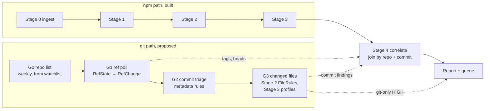

# Git path: commits on watched repositories (proposed)

> **Status:** design proposed 2026-10-29, awaiting the user's decisions G-D1 to G-D7. Nothing
> is built. The options compared, the measurements and the published GitHub limits are in
> [decision 0013](../decisions/0013-git-commit-path.md). The original decision is
> [0004](../decisions/0004-git-path-parallel-to-npm.md). Roadmap Phase 8b.

## Purpose

The npm path sees what reaches the registry. The git path sees what reaches the source
repositories of watched npm packages, often before a release and sometimes without one:

- **Malicious commits** on a default branch or a release tag, such as an install hook added, an
  obfuscated file, or a new network or process capability.
- **CI tampering:** a workflow added or changed so that it dumps secrets or publishes with
  them, including on side branches, where a push alone triggers it.
- **Release tags moved** to another commit, the shape of a tag-repointing attack.
- **Joins with npm, keyed by commit:**
  - *release without commit:* the npm release names a commit that no polled branch or tag
    contains;
  - *commit without release:* a risky change is pushed but not yet published;
  - findings on the commit a release was built from show up next to that release.

It is a second discovery source, not a replacement. Direct-to-registry publishes (stolen
tokens) never touch git, which is why the join matters.

## Where it sits



**Tick order (G-D4):** `collect` runs ingest, then Stages 1-3, then G1-G3, then Stage 4, then
reports, all under the one data-directory lock. Ingest stays first so tarball capture is never
delayed. The git path runs before Stage 4 so the join sees the same tick's ref state.

## Sources and requests

All requests go through `HttpFetcher`. The two token tiers (decision 0013, G-D1) differ only
inside the `GitHub` adapter. Both produce the same records.

| Step | T0, no token | T1, read-only fine-grained PAT |
|---|---|---|
| G1 branch and tag heads | v2 `ls-refs` per repository, `POST <repo>.git/git-upload-pack` with `ref-prefix refs/heads/`, `refs/tags/`, `HEAD`. Tags-heavy repositories (`aws-sdk-js-v3`: 2.08 MB) get heads hourly (4.8 KB) and tags once a day | GraphQL, 100 repositories per query (aliases): `defaultBranchRef`, `refs(refPrefix: "refs/heads/")`, newest tags by `TAG_COMMIT_DATE`. The full tag list comes once a day via `ls-refs` |
| G2 commits and files of a ref change | `github.com/<repo>/compare/<old>...<new>.patch`: mbox with author, date and subject per commit, plus the diff (`chalk`: 13 KB for 9 commits) | `GET /repos/{r}/compare/{old}...{new}`: commits (≤ 250), files (≤ 300) with status, blob id, patch, signature verification and `status` (ahead / behind / diverged) |
| G3 file contents | `raw.githubusercontent.com/<repo>/<commit>/<path>` per changed code file, immutable (pinned by commit), or the codeload archive when many files changed (already immutable-cached by Stage 4) | Same. REST contents would cost 1 request per file |

Never `git clone` or a git client: the path reads the HTTP protocol's bytes as data, like
`githost/github.py` does today. The v2 `ls-refs` response uses the same pkt-line format that
`parse_ref_advertisement` already parses, with a different header.

## Records (sketch, in `core/models.py` style)

Frozen pydantic `Record`s; the ones written alone are `Persisted` with `schema_version`.
Commit messages, author names, patch text and paths are **untrusted data**.

```python
class RepoRef(Record):
    """A repository on a git host, independent of any ecosystem."""

    host: str  # "github"; "gitlab" later
    owner: str
    name: str


class WatchedRepo(Record):
    repo: RepoRef
    ecosystem: str  # "npm"
    packages: tuple[str, ...]  # watched packages whose manifest *claims* this repo (unverified)
    priority: int  # deterministic poll order: max monthly downloads of `packages`


class RepoList(Persisted):  # G0, weekly, data/git/repolists/<id>.json
    built_at: datetime
    watchlist_id: str
    watchlist_sha256: str
    repos: tuple[WatchedRepo, ...]  # sorted by (host, owner, name)


class RefState(Persisted):  # G1, one per repository per tick
    repo: RepoRef
    head: str | None  # symbolic target of HEAD, e.g. "refs/heads/main"
    refs: dict[str, str]  # refs/heads/* and refs/tags/* → commit (tags peeled)
    tags_complete: bool  # False on hourly heads-only polls of tag-heavy repos
    status: Literal["ok", "transient", "gone"]  # gone = 401/403/404


class RefChangeKind(StrEnum):
    CREATED = "created"
    UPDATED = "updated"
    DELETED = "deleted"
    TAG_MOVED = "tag-moved"  # an existing tag now names another commit


class RefChange(Persisted):  # G1 output: one per ref whose commit changed
    repo: RepoRef
    ref: str
    kind: RefChangeKind
    old: str | None
    new: str | None
    default_branch: bool
    between: Window  # (as_of of the state diffed against, this run's as_of]


class GitIdentity(Record):
    name: str  # untrusted text
    email_sha256: str  # hashed: compared for "new committer", never shown raw
    date: datetime


class CommitInfo(Record):
    sha: str
    parents: tuple[str, ...]
    author: GitIdentity
    committer: GitIdentity
    subject: str  # untrusted, truncated
    signature: Literal["verified", "unverified", "unsigned", "unknown"]  # unknown on T0


class FileDelta(Record):
    path: str
    status: Literal["added", "modified", "removed", "renamed"]
    previous_path: str | None = None
    additions: int | None = None
    deletions: int | None = None


class CommitChange(Persisted):  # G2's unit of work, the git analogue of `Change`
    ref_change: RefChange
    commits: tuple[CommitInfo, ...]  # old..new, oldest first, capped
    files: tuple[FileDelta, ...]  # net change old..new, sorted by path
    truncated: bool  # host's caps (250 commits / 300 files) or ours
    ancestry: Literal[
        "fast-forward", "rewritten", "unknown"
    ]  # rewritten = old not in new's history
    packages: tuple[str, ...]  # watched packages whose directory holds a changed file
```

Candidates: a `CommitCandidate(change: CommitChange, findings, history)` with the same
`Finding` / `StageDecision` types as `Candidate`. A new class avoids changing the core
`Candidate` contract. Whether the two should share a generic base is a later, reviewed
decision.

## Steps

### G0: repository list (weekly, with the watchlist)

- Needs `WatchEntry.repository_url` (a **Stage 0 contract change**, flagged). The ecosyste.ms
  pages the watchlist build already fetches carry it, so there are no extra requests. Normalised
  with the existing `normalize_repository_url` and `GitHubRepo.from_url`.
- **Claims are unverified.** Any package can name any repository. The list keeps every claim,
  and the join checks the claim the way Stage 4 does: the repository's `package.json` with the
  release's name (`NpmLocator.package_directory`). A monorepo claimed by 386 packages
  (`aws/aws-sdk-js-v3`) is polled once.
- **R2 selection** (G-D2): repositories of watched packages that released in the last 30 days of
  recorded runs (`changes.jsonl`, from the run's `as_of`, not the clock), plus the top 5,000
  watched packages by downloads.

### G1: ref poll (hourly)

- Every repository in the list, in `priority` order. Each tick writes `RefState`s and diffs each
  one with the repository's last `ok` state, giving `RefChange`s.
- The poll records **state, not events**, so a missed tick is covered by the next diff. A push
  that is overwritten within one tick is never seen (see *Known limits*).
- `TAG_MOVED` is detected from state alone and costs nothing extra.
- Bot branches (`dependabot/*`, `renovate/*`) are polled like any other branch. G2 decides how
  far they go (G-D3).

### G2: commit triage (metadata, cheap)

One compare request per `RefChange` (created refs: compare against the default branch head).
The rules below need no file contents. A change is forwarded to G3 when any rule fires at MEDIUM
or above, or when it touches code, `package.json` or workflows on the default branch or a tag.
For other branches, only the workflow and `package.json` rules run (G-D3).

| Proposed rule | Fires when | Start severity |
|---|---|---|
| `git.tag-moved` | an existing tag names another commit (floating tags like `latest`, `v1` listed and excluded after measurement) | MEDIUM, to measure |
| `git.workflow-changed` | a file under `.github/workflows/` (or `.gitlab-ci.yml`) added or changed | LOW |
| `git.workflow-secrets` | an added workflow line serialises or sends secrets (`toJSON(secrets)`, `secrets.*` into `curl`/`wget`), or a new workflow runs `on: push` from a non-default branch | HIGH candidate, to measure |
| `npm.git.install-hook-changed` | a `package.json` install hook (`INSTALL_HOOKS`) added or changed in the range (npm-specific, `ecosystems/npm/rules/`) | MEDIUM |
| `npm.git.dependency-source` | a dependency or lockfile entry resolves outside the registry (`git+`, URL, tarball) | LOW |
| `git.history-rewritten` | the default branch's new head doesn't contain the old (`ancestry = rewritten`; T1 `status: diverged/behind`) | LOW |
| `git.signing-dropped` | earlier observed commits on the branch were verified, these aren't (T1 only) | LOW |
| `git.new-committer` | a commit on the default branch or a tag by an identity (email hash) not seen in this repository's observed history | INFO (cold start: there is no history until polling has run a while) |
| `git.backdated` | a fast-forward whose commits' author dates are older than the previous head's | LOW |

Severities and weights are starting points. Each rule gets its numbers from G2's benign week
(see *Evaluation*) before it counts in a score, as Stage 1's did.

### G3: changed files (content)

- Fetches the **new** contents of changed code and config files (JS/TS, `package.json`,
  workflows, shell). Stage 3 deltas also need the old contents, but only for JS/TS. Capped per
  change at 16 MB, like Stage 2 (decision 0008).
- **Stage 2 reuse, unchanged:** `FileRule`s are pure functions of content, and `ContentCache` is
  keyed by content hash and rules fingerprint. A file analysed on the git side is already
  cached when the npm tarball later ships the same bytes, and the reverse. `new_contents(base,
  [(commit, tree)])` already computes "contents not in the base".
- **Stage 3 reuse:** `profile(tree, cache)` and `added(before, after)` take a `Tree` and work
  as they are. `CodeChange` holds an npm `VersionSnapshot`, so commit-side `CodeRule`s need a
  subject that isn't a release. That is a **Stage 3 contract change**, flagged, for G3's
  review.
- `repo.code-differs` and similar Stage 4 rules aren't reused. They compare npm with git, and
  the join does that.

### Join with Stage 4 (G4)

Keyed by `(host, owner/name, commit)`. Stage 4 records the git runs it read (id + SHA-256), as
runs already record their watchlist.

1. **Commit source:** provenance `gitCommit` is used after `gitHead` and before tags. 60% of
   watched updates have provenance, against 34.8% with `gitHead`. This needs the provenance
   attestation (`dist.attestations.url`), a Stage 0 or Stage 4 fetch: **flagged**.
2. **Context:** a release whose commit (or a commit in its range since the previous release) has
   git-path findings gets `npm.repo.commit-flagged`, with those findings as evidence.
3. **Fresher tags:** Stage 4 uses the tick's `RefState` tags (when `tags_complete`) instead
   of fetching the v0 advertisement (up to 3 MB for tag-heavy repositories) again.
4. **Release without commit (late join):** a release is checked again 24 h after its `as_of`
   (the run's, not the clock): is its commit a polled head or tag, or among the commits G2
   recorded? It is reported as `npm.repo.release-without-commit`, **INFO until measured**:
   15% of sampled benign `gitHead`s were never pushed (correlate.md). The 24 h grace covers
   tags pushed after `npm publish`.
5. **Commit without release:** a G2/G3 HIGH on the default branch or a tag is a review item on
   its own (G-D6). A later release of the package then links to it through step 2.

## Storage and retention (estimates, to be measured in G1)

The VM has ~393 GB. The npm path's projected steady state is ~256 GB (tarballs 14 GB/day × 7,
archives 30 GB/day × 4, packuments 5.5 GB/day × 7). The git path's budget is **≤ 5 GB/day at
4 days (≤ 20 GB)** (G-D5). The blob store is content-addressed, so an unchanged repository's
identical poll response adds only a snapshot entry (~250 bytes), not a blob.

| Item, R2 (~5k repositories, assumed) | Per day (estimate) | Basis |
|---|---|---|
| G1 polls, T0 heads hourly | 120k requests. ~30 MB of snapshot entries, ~0.2 GB of new bodies | heads-only 2-5 KB (`aws-sdk-js-v3` 4.8 KB); ~20% of polls change (assumed) |
| G1 full tag lists, daily | ~0.15 GB | 5k × ~30 KB mean (assumed; `react` 96 KB, `chalk` 5 KB) |
| G1 polls, T1 GraphQL | 1.2k queries, ~0.1 GB | 100 repos per query, ~1 KB each (assumed) |
| G2 compares | 0.2-1 GB | 2-10k ref changes a day (unmeasured; 30-157 watched repos *release* per hour) × 10-100 KB |
| G3 contents | 0.4-1.2 GB | 1-3k forwarded changes × ~10 files × ~20 KB × 2 (assumed) |
| **Total, R2** | **~1-2.5 GB** | Within budget. R1 (all repositories) may be ~5×, so measure before choosing it |

Retention: a `--keep-git-days` (default 4) for G2/G3 bodies, like `--keep-repo-days`. The last
`ok` `RefState` per repository is **state**, kept until the repository leaves the list. Without
it the next diff has no base.

Tick time (estimate): T0, 5k requests at the fetcher's per-host pacing ≈ 5-10 min; T1, 50
GraphQL queries ≈ seconds; G2, ~400 compares an hour ≈ 2 min. To measure in G1.

## Failure handling (decision 0009)

- **Transient vs. permanent** as everywhere: `TransientFetchError` (attempts ran out on
  connection errors or 429/5xx) is transient. A 404/401/403 on a repository makes it `gone`,
  which is recorded and rechecked at the next weekly list. Malformed responses are permanent.
- **G1 never advances a repository's state on failure.** A `transient` `RefState` keeps the
  last `ok` state as the base, so the next successful poll's diff covers both ticks
  (`between` spans them). Nothing is lost except pushes overwritten in the meantime.
- **Outage guard, as in Stage 0:** if ≥ 20% of the repositories (and ≥ 20) fail transiently,
  the git run writes nothing and the state stays put. The tick logs it, and the Discord update
  says so.
- **GitHub's secondary limits** answer 403 or 429 with `Retry-After`. `HttpFetcher` treats only
  429/5xx as retryable and doesn't expose response headers, so a 403-with-`Retry-After` would
  look permanent. That needs a **fetcher change** (classify it as transient), flagged with the
  POST extension. Requests are paced per host and sent serially per GitHub's advice.
- **Count-based budget per tick:** at most `GIT_REQUEST_BUDGET` requests per step (T1: well
  under 5,000/hour REST and 5,000 points/hour GraphQL). Overflow is carried to the next tick as
  retry items, in a deterministic priority order: tags, then default branches, then downloads.
  The budget counts requests, not seconds: analysis never reads the clock.
- **G2/G3 retry items** live in the git state, like Stage 0's `RetryItem`, and expire after
  `MAX_CHAIN_GAP` (7 days). A compare or file that answers 404 (commit force-pushed away and
  collected) is permanent. It is recorded as `commit unavailable`, which is itself evidence for
  `git.history-rewritten`.

## Determinism and replay

- A git run is `data/runs/<id>-git/`: `manifest.json` (`as_of`, the `RepoList` id + SHA-256,
  the base `RefState` set id + SHA-256, the token tier but never the token, rule fingerprint),
  `snapshot.json`, `refs.jsonl`, `ref-changes.jsonl`, `commits.jsonl`, `git-triage.jsonl`,
  `git-static.jsonl`. `kitsunox git replay <run_id>` must print "identical", like ingest.
- POST requests get a request key of method + URL + SHA-256 of the body.
  `Authorization` is never part of the key, the snapshot, the logs or the run directory.
- Every list in output is sorted by a defined key (repository, ref, commit order from the host,
  path).

## Safety

- No git client, no checkout, no hooks: HTTP bytes only, archives through `extract_tar_gz`.
- Paths from diffs are untrusted. A raw-file URL is built only from a path that passes the
  extractor's checks (no `..`, no absolute paths), percent-encoded.
- Commit messages, author names, patch text and workflow contents are untrusted. Renderers
  escape them (`reporting/markdown.py`). Author emails are stored hashed.
- The token (T1) has public read-only access and no permissions. It lives in `.env` and is
  loaded through `util/env.py`, never printed.

## Evaluation

Git-side labels are scarce, and that has to be said plainly in every result:

- **The DataDog samples are npm tarballs and the OSV `MAL-` records name packages, not
  commits.** Neither says which commit, if any, carried an attack.
- **State-based signals can't be measured retrospectively.** Ref history before polling
  starts can't be reconstructed (a moved tag looks like any other tag today). `day1` can't
  score `git.tag-moved` or *release without commit*. Those numbers come only from prospective
  collection.

What can be measured:

1. **Incident fixtures (labelled test data, inert):** a curated list of public incidents where
   the repository, ref and commits are still fetchable as data, each with its source. These
   are candidates to verify in G2, from memory, so not yet checked: tag repointing in
   `tj-actions/changed-files` (2025-03; a GitHub Action, but `git.tag-moved` is
   ecosystem-agnostic); workflows pushed into victims' repositories by Shai-Hulud (2025-09,
   2025-11) and by GhostAction (2025-09); Nx "s1ngularity" (2025-08: a workflow weakness, then
   npm releases whose payload never reached git, a *release without commit* positive). The
   fixtures are stored under `data/eval/git/` (gitignored) and only read, never run.
2. **Injection (synthetic recall for routing and content rules):** recorded benign
   `CommitChange`s with DataDog payload files, install hooks or workflow lines inserted, as
   data. This measures whether G2 routes and G3 detects tarball-style payloads when they arrive
   by commit. It says nothing about real git-side attacker behaviour.
3. **Join recall, prospective:** malicious releases of polled packages (DataDog or later
   `MAL-` records) checked for `commit-flagged` and `release-without-commit`. These are
   expected to be few.
4. **Benign rates, from the first week of G1-G3:** ref changes per day, the share G2 forwards
   (target ≤ 10%, to agree at gate 2), git-only items in the queue per day, and a manual review
   of 50 forwarded changes. The results go in `docs/evaluation.md`.

## Build plan, with review gates

| Phase | Work | Gate (user review) |
|---|---|---|
| **G0 Measure** | `WatchEntry.repository_url` (Stage 0 change, approved separately). Count R1 and R2 repositories. For 500 sampled repositories: `ls-refs` sizes (heads, tags) and, with a token, GraphQL `rateLimit { cost }`. One hour of anonymous polling at a fixed pace, watching for 403/429. Check whether `codeload` serves a commit that exists only in a fork (if it does, Stage 4's "commit is in the repository" is weaker than assumed) | Choose G-D1 and G-D2 with the numbers |
| **G1 Poll** | `GitHost` protocol + GitHub adapter (T0 and/or T1); `RepoList`, `RefState`, `RefChange`; `HttpFetcher` POST + 403-`Retry-After` (util change, reviewed); git state, retry items, outage guard; `kitsunox git poll` and `git replay`. Runs in `collect` for a week with nothing downstream | Ref changes/day, bytes/day, tick time, no throttling |
| **G2 Triage** | Compare fetch, `CommitChange`, the metadata rules above, incident fixtures | Benign forward rate; fixture recall |
| **G3 Content** | Changed-file fetch; Stage 2 `FileRule`s via `ContentCache`; Stage 3 profiles (contract change reviewed); injection eval | Storage within budget; benign rate |
| **G4 Join** | Stage 4: provenance commit source, `commit-flagged`, `RefState` tags, late join for *release without commit* (INFO) | A week of benign *release without commit* numbers before any weight |
| **G5 Report** | Git items in `report.json`, the queue and the Discord update | Report review |
| Later | GitLab adapter behind `GitHost`; pull-request refs | Separate decision |

Each phase is one task with its own tests and docs, as CLAUDE.md asks ("one stage at a time").
Contract changes elsewhere (watchlist, fetcher, Stage 3, Stage 4) are their own reviewed steps.

### Interfaces (sketch)

```python
class GitHost(Protocol):  # githost/
    name: str  # "github"

    def parse_repo(self, url: str | None) -> RepoRef | None: ...
    def poll(self, repos: Sequence[RepoRef], *, tags: bool) -> Mapping[RepoRef, RefState]: ...
    def compare(self, repo: RepoRef, old: str | None, new: str) -> CommitChange: ...
    def file(self, repo: RepoRef, commit: str, path: str) -> bytes: ...  # immutable
    def archive(self, repo: RepoRef, commit: str, *, directory: str = "") -> ArtifactTree: ...


class PackageLayout(Protocol):  # ecosystems/<eco>/: what a repo path means
    def packages_for(self, files: Sequence[FileDelta], repo: Tree | None) -> tuple[str, ...]: ...
    def is_manifest(self, path: str) -> bool: ...  # package.json
```

## Known limits

- **Pushes overwritten within a tick** (pushed and force-pushed back, or a tag moved and moved
  back) are invisible to state polling.
- **Pull requests from forks** aren't in the repository until merged. `refs/pull/*` is not
  polled, so "pwn request" workflow runs are out of scope.
- **Commits that exist only in a fork** may be served under the parent repository's URL (to be
  checked in G0). If so, a `gitHead` that looks "in the repository" may not be on any of its
  branches. The join's reachability check (polled heads, tags and observed commits) is the
  remedy.
- **Cold start:** `git.new-committer` and `git.signing-dropped` need observed history, so
  they say nothing for the first weeks of polling.
- **T0 throughput is unknown.** GitHub's anonymous limits are unpublished (2025-05-08).
- **GitHub only** at first. GitLab released 0.1% of the measured day's watched packages.
- **Release-without-commit is noisy by nature:** benign projects publish from unpushed
  working trees. It stays INFO until the numbers say otherwise.
