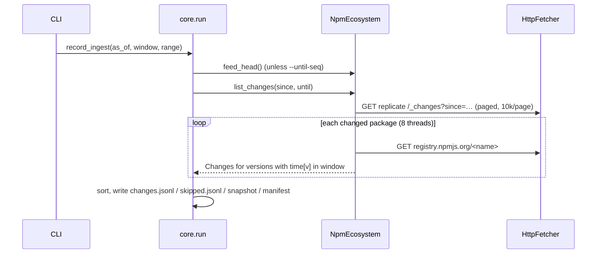

# Stage 0: Ingest

> **Status:** implemented for npm (2026-10-27), including popularity from a weekly watchlist.

## Purpose

Turn "what changed on npm recently" into `Change` records. Each record pairs one newly published
version with the version it should be diffed against. Every byte fetched is captured so the run
can be replayed offline with identical output.

## Usage

```sh
# Continuous mode: read the feed from the last checkpoint (first run: last 400k feed positions),
# keep versions published in the 24h before now.
uv run kitsunox ingest record

# Ad-hoc range (doesn't move the checkpoint)
uv run kitsunox ingest record --since-seq 140114769 --until-seq 140117769 --window-hours 2

# Weekly: build the popularity watchlist (required by the default --popularity watchlist)
uv run kitsunox watchlist build

# Re-run offline from the run's snapshot and verify byte-identical output
uv run kitsunox ingest replay 20261027T184048Z-npm
```

Output lives in `data/runs/<run_id>/`:

| File | Content |
|---|---|
| `manifest.json` | `RunManifest`: window, feed range, tool version, snapshot and output hashes, counts |
| `snapshot.json` | Every HTTP response the run used (request key → blob hash, status, fetch time) |
| `changes.jsonl` | One `Change` per line, sorted by (ecosystem, name, version) |
| `skipped.jsonl` | Packages that couldn't be processed, with the reason |

Response bodies live once in `data/blobs/`, zstd-compressed and addressed by SHA-256.

## How it works



1. **Feed range.** `until` = `--until-seq` or the feed head. `since` = `--since-seq`, else the
   saved checkpoint, else `until − lookback`. Only the default (checkpoint) mode advances the
   checkpoint.
2. **Feed.** `_changes` returns `{seq, id}` only (see
   [decision 0002](../decisions/0002-data-sources.md)). A package appears once, at its latest
   sequence. `_design/` documents are ignored. Paging stops if the feed doesn't advance.
3. **Packument.** One full packument per package (`Accept: application/json`). A 404 means the
   package is gone, and yields no changes.
4. **Window.** A version is "recent" if `window.start < time[version] ≤ window.end`. The window
   ends at `as_of`, which is recorded, so replay never reads the clock.
5. **Previous version.** Among versions published *before* the new one: the highest semver lower
   than it, so a backport like 1.4.1 published after 2.0.0 is diffed against 1.4.0. If none
   qualifies, the most recently published earlier version is used. No earlier version means a
   brand-new package (threat-model shape B).
6. **Popularity** (existing packages only; brand-new packages have no history). Three modes:
   - `watchlist` (default): membership in the newest watchlist built no later than `as_of`. The
     run records its id and SHA-256, and replay fails if the file has changed. No network.
   - `api`: per-package npm downloads API lookups for a fixed 7-day period ending 2 days before
     `as_of`. Bulk for unscoped names (128/request). Scoped names are one request each, paced to
     0.5 s apart (the API returns 429 on bursts). Successful responses are cached across runs.
     Slow: see [decision 0003](../decisions/0003-popularity-watchlist.md).
   - `none`.

   `Popularity.watched` is what the Stage 1 forward policy will use (cutoff ≥10k weekly).
7. **Snapshot of each version.** `PublishInfo` (publisher, trusted-publisher provider, staged-publish
   approver, provenance present, `gitHead`, maintainers), `ArtifactRef` (tarball URL + integrity;
   non-HTTPS URLs are refused), and the manifest minus `readme`. The repository URL is
   normalized to `https://github.com/<owner>/<repo>` where possible, dropping any monorepo
   sub-path.

## Safety

- Packuments are untrusted. Every field is type-checked, and wrong types are ignored instead of
  trusted (see `tests/fixtures/npm/packument_basic.json`). A package that raises anyway is
  recorded in `skipped.jsonl` instead of crashing the run.
- Tarballs (fetched by later stages through `NpmEcosystem.fetch_artifact`) must carry a digest.
  They're verified against `dist.integrity` (or the legacy `shasum`) and extracted **in memory**
  by `util.archive.extract_tar_gz`:
  - Unsafe paths, links, devices and FIFOs are reported, not extracted.
  - Size, count and ratio limits stop archive bombs.
  - Trailing data after the gzip stream is rejected.
  - Nothing is written to disk or executed.
- Replay installs a transport that fails any network request.

## Measurements (2026-10-27, single live sample)

| Metric | Value |
|---|---|
| Feed positions → packages | 3,000 positions → ~1,070–1,210 packages |
| Packages → changes (2h window) | ~1,200 → ~1,800 (CI-driven packages publish several versions per window) |
| Brand-new packages | 45 of 1,821 changes (2.5%) |
| Trusted publishing / provenance | 724 / 612 of 1,821 new versions (~40% / ~34%) |
| Install scripts (`pre/post/install`) | 29 of 1,821 |
| GitHub repository URL | 1,236 of 1,821 (562 have none) |
| Throughput | ~1,200 packages in 34s with 8 workers (~35 packages/s) |
| Blob storage | 1.4 GB uncompressed → 119 MB with zstd (≈10×) |
| Tarball extraction | 59 of 60 random tarballs extracted cleanly; 1 returned 404 (removed after publish) |
| Replay | byte-identical (`ingest replay` digest match) |

Extrapolated to a full day (~100k packages): about 50 minutes of fetching and about 10 GB of
compressed blobs. That still needs a retention policy (open question below).

## Known limits

- **Popularity is up to a week stale** (watchlist rebuilt weekly; ecosyste.ms adds its own sync
  lag). Packages with many dependents but few downloads aren't watched (dependents aren't a
  criterion yet).
- **Coalesced feed entries.** If a package changes again after `until`, its earlier entry moves
  past the range. The next run picks it up, but only if its publish time is still inside that
  run's window.
- **Re-processing across runs.** A package modified for an unrelated reason (dist-tag, deprecate)
  shows up in the feed again, and its in-window versions are emitted again. Cross-run dedupe is
  not implemented.
- **Full packuments are large.** Packages with thousands of versions produce multi-MB documents.
  The abbreviated format lacks the per-version `time` map and `_npmUser`, so it can't replace
  them.
- **Repository URLs** are only normalized for GitHub. Others are kept as given.

## Tests

`tests/ecosystems/npm/` (packument parsing, previous-version choice, semver, registry adapter),
`tests/util/` (fetcher record/replay/retry, extractor safety, integrity), `tests/stages/test_ingest.py`,
`tests/core/test_run.py` (record → replay identical, checkpoints). Live check:
`uv run pytest -m network`.
