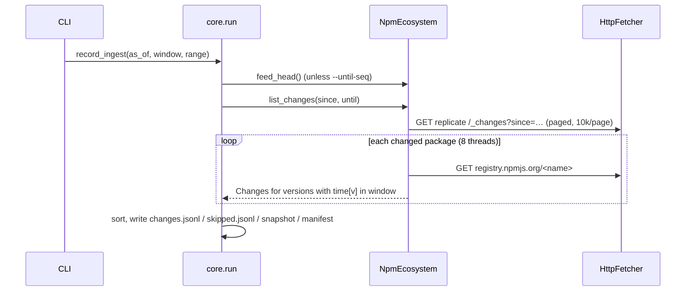

# Stage 0: Ingest

> **Status:** implemented for npm (2026-10-27), including popularity from a weekly watchlist.

## Purpose

Turn "what changed on npm recently" into `Change` records. Each record pairs one newly published
version with the version it should be diffed against. Every byte fetched is captured so the run
can be replayed offline with identical output.

## Usage

```sh
# Continuous mode: read the feed from the last checkpoint (first run: last 400k feed positions),
# keep versions published in the 24h before now.
uv run kitsunox ingest record

# Ad-hoc range (doesn't move the checkpoint)
uv run kitsunox ingest record --since-seq 140114769 --until-seq 140117769 --window-hours 2

# Weekly: build the popularity watchlist (required by the default --popularity watchlist)
uv run kitsunox watchlist build

# Re-run offline from the run's snapshot and verify byte-identical output
uv run kitsunox ingest replay 20261027T184048Z-npm

# Chained: continue from the previous run (window starts 15 min before it ended)
uv run kitsunox ingest record --chain

# Unattended: what the hourly agent (systemd or launchd) runs (watchlist/labels refresh, chained run, prune)
uv run kitsunox collect
uv run kitsunox data prune --keep-days 7    # --keep-repo-days N: GitHub archives (Stage 4) sooner
```

**Scheduling.** Collection runs on a Linux VM since 2026-10-29, as a systemd user timer:

```sh
uv run kitsunox schedule systemd --keep-days 2 --keep-repo-days 2   # writes ~/.config/systemd/user/kitsunox-collect.{service,timer}
systemctl --user daemon-reload
systemctl --user enable --now kitsunox-collect.timer
sudo loginctl enable-linger "$USER"                     # keep ticking while logged out
systemctl --user start --no-block kitsunox-collect.service   # a tick now, without waiting
```

The service is `Type=oneshot` at low CPU and I/O priority. The timer fires `--interval-minutes`
(60) after the previous tick *started*. A tick that runs longer is never started twice; the next
one follows as soon as it ends, and `DataDir.lock()` guards the data directory regardless.
Remove it with `systemctl --user disable --now kitsunox-collect.timer`. Check it with
`systemctl --user list-timers` and `journalctl --user -u kitsunox-collect`.

On macOS (the laptop, until 2026-10-29), the same job is a launchd agent:
`uv run kitsunox schedule plist > ~/Library/LaunchAgents/local.kitsunox.collect.plist` and
`launchctl bootstrap gui/$(id -u) ~/Library/LaunchAgents/local.kitsunox.collect.plist`. Remove
it with `launchctl bootout gui/$(id -u)/local.kitsunox.collect`.

Either way, the log is `data/logs/collect.log`. Design:
[0006](../decisions/0006-scheduled-collection-and-retention.md).

**Run updates.** If `KITSUNOX_DISCORD_WEBHOOK` is set (in `.env` or the environment), the first
tick of each UTC day posts a summary of the day before to that Discord channel: ticks (crashed,
with failed steps, offline), runs and versions, how many versions and packages to review by
severity (a version two overlapping runs reported counts once), the top packages, chain gaps and
network skips. Each tick appends a line to `data/state/ticks.jsonl` for it;
`data/state/notify.json` remembers the last day posted. A crash is posted right away, at most
once a day. `--notify-each-tick` also posts the old brief update after every tick;
`--no-notify` turns posting off. A skipped tick posts nothing. Package names are escaped and
mentions disabled, and the URL is never logged. See
[0011](../decisions/0011-run-notifications.md).

Output lives in `data/runs/<run_id>/`:

| File | Content |
|---|---|
| `manifest.json` | `RunManifest`: window, feed range, tool version, snapshot and output hashes, counts |
| `snapshot.json` | Every HTTP response the run used (request key → blob hash, status, fetch time) |
| `changes.jsonl` | One `Change` per line, sorted by (ecosystem, name, version) |
| `skipped.jsonl` | Packages that couldn't be processed, with the reason |
| `retention.json` | Only on pruned runs (older than 7 days): the pinned snapshot entries. `changes.jsonl` is then `changes.jsonl.zst` and the run can't be replayed |

The manifest's `changes_sha256` is the SHA-256 of the `changes.jsonl` lines followed by the
`skipped.jsonl` lines, joined by newlines; `ingest replay` recomputes it from the replayed
records. Since 2026-11-08 it is hashed a line at a time (`changes_digest`), so neither recording
nor replay holds the run as one string: the joined string had taken ~6x the file's size once a
line held an emoji. The formula is unchanged, so older runs still replay.

Response bodies live once in `data/blobs/`, zstd-compressed and addressed by SHA-256.

## How it works



1. **Feed range.** `until` = `--until-seq` or the feed head. `since` = `--since-seq`, else the
   saved checkpoint, else `until − lookback`. Only the default (checkpoint) mode advances the
   checkpoint. A chained run reads at most `MAX_RUN_FEED_SPAN` (250,000) positions: after a
   long gap the catch-up is split over several runs, one per `collect` tick, each with the
   whole gap's window (the checkpoint keeps the earlier `as_of` until a run reaches the feed
   head, recorded as `feed_head`). See the 2026-11-08 addendum to
   [0006](../decisions/0006-scheduled-collection-and-retention.md).
2. **Feed.** `_changes` returns `{seq, id}` only (see
   [decision 0002](../decisions/0002-data-sources.md)). A package appears once, at its latest
   sequence. `_design/` documents are ignored. Paging stops if the feed doesn't advance.
3. **Packument.** One full packument per package (`Accept: application/json`). A 404 means the
   package is gone, and yields no changes.
4. **Window.** A version is "recent" if `window.start < time[version] ≤ window.end`. The window
   ends at `as_of`, which is recorded, so replay never reads the clock.
5. **Previous version.** Among versions published *before* the new one: the highest semver lower
   than it, so a backport like 1.4.1 published after 2.0.0 is diffed against 1.4.0. If none
   qualifies, the most recently published earlier version is used. No earlier version means a
   brand-new package (threat-model shape B).
   **A partial publish is passed over** (diff base 2, since 2026-10-30): a candidate with under
   a quarter of the files (`dist.fileCount`; else `dist.unpackedSize`) of both the new version
   and the release before it, at most 3 in a row (`Packument.previous_version`). The case:
   `@nutui/nutui-react-taro@3.0.24-cpp-beta.3` shipped 166 of 5,215 files, so `beta.4` looked
   as if it had added the build, a postinstall and a dependency that `beta.2` already had
   (score 20, rank 1 of the first VM day). A release only smaller than the new one is kept, so
   a release can't push its own diff base back by being large (to an older version that
   already had its install script, say). The rule is recorded per run
   (`RunManifest.diff_base`; runs recorded before it read as 1) and a replay uses the run's.
   On the first VM day it changed the diff base of 41 of 101,232 updates (13 reported).
   **A platform build is passed over** (diff base 3, since 2026-10-31) for a release that
   isn't one: a prerelease naming an OS and a CPU (`0.5.4-latest-windows-x64`,
   `0.1.19-linux-x64`, `0.2.19-daily.20261029.win32-x64`; `packument.platform_build`).
   `@ozyman42/ozy-cli@0.5.4` was diffed against `0.5.4-latest-windows-x64`, published just
   before it with one platform's binary and no postinstall, so its own postinstall read as
   added (HIGH). 40 of 228,298 changes on the first two VM days had such a base, 8 of them
   reported. A platform build is still analysed itself, and is still the base when nothing
   else qualifies.
   **Diff base 4** (2026-10-31) counts OpenHarmony builds as platform builds
   (`0.2.19-daily.20261030.ohos-arm64`): `@bitfun-test/bitfun`'s daily release was diffed
   against one and its postinstall read as changed (HIGH).
6. **Popularity** (existing packages only; brand-new packages have no history). Three modes:
   - `watchlist` (default): membership in the newest watchlist built no later than `as_of`. The
     run records its id and SHA-256, and replay fails if the file has changed. No network.
   - `api`: per-package npm downloads API lookups for a fixed 7-day period ending 2 days before
     `as_of`. Bulk for unscoped names (128/request). Scoped names are one request each, paced to
     0.5 s apart (the API returns 429 on bursts). Successful responses are cached across runs.
     Slow: see [decision 0003](../decisions/0003-popularity-watchlist.md).
   - `none`.

   `Popularity.watched` is what the Stage 1 forward policy will use (cutoff ≥10k weekly).
7. **Snapshot of each version.** `PublishInfo` (publisher, trusted-publisher provider, staged-publish
   approver, provenance present, `gitHead`, maintainers), `ArtifactRef` (tarball URL + integrity;
   non-HTTPS URLs are refused), and the manifest minus `readme`. The repository URL is
   normalized to `https://github.com/<owner>/<repo>` where possible, dropping any monorepo
   sub-path.

## Safety

- Packuments are untrusted. Every field is type-checked, and wrong types are ignored instead of
  trusted (see `tests/fixtures/npm/packument_basic.json`). A package that raises anyway is
  recorded in `skipped.jsonl` instead of crashing the run.
- Network failures are different from bad data. A package skipped because the network failed
  (`transient: true` in `skipped.jsonl`) goes into the checkpoint's retry list. The next
  chained run fetches it again. If more than 20% of a run's packages fail that way, the run
  writes nothing (`IngestDegradedError`). See
  [0009](../decisions/0009-network-failure-handling.md).
- Tarballs (fetched by later stages through `NpmEcosystem.fetch_artifact`) must carry a digest.
  They're verified against `dist.integrity` (or the legacy `shasum`) and extracted **in memory**
  by `util.archive.extract_tar_gz`:
  - Unsafe paths, links, devices and FIFOs are reported, not extracted.
  - Entries a strict tar reader would miss (after an end-of-archive marker or an invalid header)
    are still extracted, and recorded as `anomalies`. Trailing non-zero data and truncated gzip
    streams are rejected or flagged too.
  - Size, count and ratio limits stop archive bombs.
  - Trailing data after the gzip stream is rejected.
  - Nothing is written to disk or executed.
- Replay installs a transport that fails any network request.

## Measurements (2026-10-27, single live sample)

| Metric | Value |
|---|---|
| Feed positions → packages | 3,000 positions → ~1,070–1,210 packages |
| Packages → changes (2h window) | ~1,200 → ~1,800 (CI-driven packages publish several versions per window) |
| Brand-new packages | 45 of 1,821 changes (2.5%) |
| Trusted publishing / provenance | 724 / 612 of 1,821 new versions (~40% / ~34%) |
| Install scripts (`pre/post/install`) | 29 of 1,821 |
| GitHub repository URL | 1,236 of 1,821 (562 have none) |
| Throughput | ~1,200 packages in 34s with 8 workers (~35 packages/s) |
| Blob storage | 1.4 GB uncompressed → 119 MB with zstd (≈10×) |
| Tarball extraction | 59 of 60 random tarballs extracted cleanly; 1 returned 404 (removed after publish) |
| Replay | byte-identical (`ingest replay` digest match) |

Extrapolated to a full day (~100k packages): about 50 minutes of fetching and about 10 GB of
compressed blobs. Measured on the first real 24h run: 46.5 minutes and 5.5 GB. Retention is in
[0006](../decisions/0006-scheduled-collection-and-retention.md). A chained hourly tick took
2m23s for 70 minutes of feed (3,502 packages), and 9s for 3 minutes of feed.

## Known limits

See also [validation.md](../validation.md) for measured results.

- **npm's feed omits some publishes.** In one validation sample, 1 of 149 releases (0.7%) never
  appeared in `_changes`. A supplementary discovery source is an open question.
- **Window coverage is estimated, not exact.** The 1st percentile of packages' last-modified
  times estimates where the feed range starts (`feed_start_estimate`). Runs record
  `window_covered`, and the CLI warns if it's false. The default 400k lookback reached ~31h when
  probed on 2026-10-27.

- **Popularity is up to a week stale** (watchlist rebuilt weekly; ecosyste.ms adds its own sync
  lag). Packages with many dependents but few downloads aren't watched (dependents aren't a
  criterion yet).
- **Coalesced feed entries.** If a package changes again after `until`, its earlier entry moves
  past the range. The next run picks it up, but only if its publish time is still inside that
  run's window.
- **Re-processing across runs.** A package modified for an unrelated reason (dist-tag, deprecate)
  shows up in the feed again, and its in-window versions are emitted again. Chained runs add a
  15-minute overlap on purpose. Datasets dedupe across runs (the earliest run wins); runs
  themselves don't. A sliced catch-up adds more: a package that changes again during it is read
  again by a later slice, over the whole gap's window.
- **Full packuments are large.** Packages with thousands of versions produce multi-MB documents.
  The abbreviated format lacks the per-version `time` map and `_npmUser`, so it can't replace
  them.
- **Staged-publishing stubs.** npm creates a `0.0.0-stage` placeholder (`"stub": true`) before a
  new package's first real release; 98% of "new packages" in the first 24h run were such stubs.
  Since tool 0.2.0 a stub is never used as the previous version (so the first real release is
  shape B), but stubs are still emitted, because `stub` is publisher-controlled.
- **Repository URLs** are only normalized for GitHub. Others are kept as given.

## Tests

`tests/ecosystems/npm/` (packument parsing, previous-version choice, semver, registry adapter),
`tests/util/` (fetcher record/replay/retry, extractor safety, integrity), `tests/stages/test_ingest.py`,
`tests/core/test_run.py` (record → replay identical, checkpoints). Live check:
`uv run pytest -m network`.
