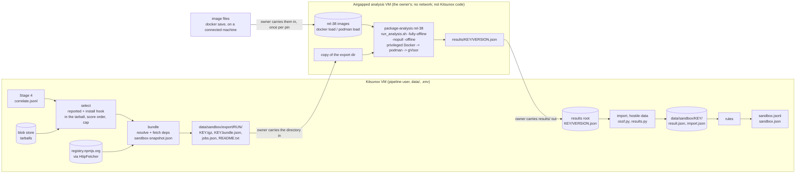

# Stage 5: Dynamic analysis with OpenSSF package-analysis

> **Status:** pipeline side built (export, import, rules, offline dependency bundles) and
> wired into the CLI (`kitsunox sandbox`) and `collect` (only when a results root is
> configured); reports include Stage 5's findings. The dynamic analysis itself is done by
> [OpenSSF package-analysis](https://github.com/ossf/package-analysis), pinned at **rel-38**,
> which the project owner installs and runs on a separate, **airgapped** analysis VM by
> following that project's documentation. Kitsunox never runs package-analysis, Docker, gVisor,
> `npm`, `node` or package code. Every job is exported for the airgapped VM
> (`-fully-offline -nopull -offline`); there is no online mode (the owner's decision,
> [0014](../decisions/0014-stage5-uses-ossf-package-analysis.md#network-decision)). Threats to
> the host and the runtime facts about the VM:
> [decision 0012](../decisions/0012-sandbox-design.md), which still applies to the machine
> that runs package-analysis. A selected version whose `package.json` needs dependencies is
> exported as a Kitsunox-built **offline dependency bundle** (the package plus every dependency
> npm would install), so its install hooks run without a network
> ([design note](../proposals/offline-dependency-bundle.md); see
> [Offline dependency bundles](#offline-dependency-bundles-sandboxbundlepy)). The bundle
> mechanics come from reading npm 11.12.1's source and are not yet confirmed by an owner run
> (the design's evaluation step 1).

## Purpose

Stages 1-4 read packages as data. They can't tell whether an obfuscated `postinstall` really
reads `~/.ssh/id_rsa`, which host a downloader contacts, or whether a hook runs `npm publish`.
Stage 5 has those versions installed in package-analysis's gVisor sandbox, imports what it
recorded (commands, files, sockets, DNS questions), and turns that into named findings with
evidence, like every other stage.

It does **not** raise recall: it only sees versions Stage 4 already reports. What it adds is
precision, evidence and queue order. A run that observes nothing proves nothing (malware
detects sandboxes and waits), so Stage 5 never lowers a score or clears a version.

## Where it sits



The two sides meet only through files carried across the airgap: an export directory Kitsunox
writes, and a results root the owner fills with package-analysis's output, which Kitsunox reads
as hostile. Every path in the export is relative to it, so it can be copied to another machine.
The analysis VM has no network at all, so package-analysis's images reach it as files too. The analysis is
therefore asynchronous: one call of the stage exports tarballs, the owner analyses them (hours
or days later), and a later call imports the results and re-renders the runs that exported
them.

## Usage

```sh
uv run kitsunox sandbox <run_id> --results /path/to/results   # import, then export this run
uv run kitsunox sandbox <run_id> --replay                       # reproduce sandbox.jsonl offline
```

`--results` defaults to `KITSUNOX_SANDBOX_RESULTS` (environment or `.env`; not a secret). With a
results root configured, `collect` also runs Stage 5 after the report on every run whose stages
ran that tick (import, refresh, export) and logs one line per run: how many reported versions
have hooks, analysed, awaiting analysis, bundled, where the export is, and overdue jobs.
Without one, `collect` skips Stage 5 and the CLI exports nothing. The data-dir prune
(`collect`'s daily prune and `kitsunox data prune`) also drops pruned runs' exports and every
cached result no run refers to (`results.prune_sandbox`), and keeps the bundles' dependency
tarballs with their run (`sandbox-snapshot.json` is one of `core/run.py`'s
`STAGE_SNAPSHOTS`).

The Python entry point is
`kitsunox.stages.sandbox.run_sandbox_stage(data, run_id, results=...)` (caller holds
`DataDir.lock()`). It takes no network argument: every job is for the airgapped VM.

- `results` is the results root: where the owner puts the contents of each export's
  `results/` directory, one `<key>/` per job. With `results=None` nothing is exported or
  imported (selected versions get `sandbox.not-run` "not configured"), but results already
  cached are still applied.
- `overdue_after` (default 2 days) sets when the result's `overdue` lists a run whose jobs
  still have no answer.
- `replay=True` reads only the cache, the run's tarballs, its `sandbox-snapshot.json` (to
  rebuild bundles) and what the run's `sandbox.json` recorded.
- `client` is the HTTP client for the bundle step's `HttpFetcher` (tests pass a mock
  transport; `None`: the fetcher's own). `bundle_budget` (default 2 GiB) caps the new bytes the
  bundle step downloads in one call, over every run it renders.

The result (`SandboxStageResult`) has the run's candidates, `refreshed` (earlier runs rendered
again: rebuild their reports), `imported` (key to import outcome) and `overdue` (run id to the
number of its exported jobs with no answer yet, for runs exported more than `overdue_after`
before this run's `as_of`). After a live call, `collect.run_sandbox` rebuilds the report of
the run and of every refreshed run: a reported version is then read from `sandbox.jsonl`, so
Stage 5's findings appear under "Stage 5: sandbox" and count in its score, and the index says
how many versions were analysed or are still waiting (`reporting/report.py`).

## Which versions enter (`sandbox/select.py`)

- **Entry rule:** Stage 4 reported the version (its last decision is `correlate`,
  forwarded) **and** the tarball's own `package.json` makes `npm install` run a hook:
  non-empty `preinstall`, `install` or `postinstall`, or npm's implicit
  `install: node-gyp rebuild` when there's a `binding.gyp`, neither `install` nor
  `preinstall`, and no `"gypfile": false`. The tarball is what npm reads, so it is what
  counts; registry metadata can differ from it (manifest confusion). The tarball is read with
  `util.archive.extract_tar_gz` and nothing is run.
- **Where the tarball comes from:** the run's Stage 2 or Stage 4 snapshot when an earlier
  stage captured it; otherwise Stage 5 downloads it itself (`_download`; a download, nothing
  run). On the first VM day 78 of 984 reported versions had no captured tarball: 57 over
  Stage 2's 16 MB cap (platform binaries) and 21 reported by Stage 4's dependency rules after
  Stage 1 passed them over. Only a live call with a results root downloads, only
  `https://registry.npmjs.org/` tarball URLs (`bundle.registry_tarball_url`), in score order,
  through the stage's recording fetcher (`sandbox-snapshot.json`, the immutable index), and
  the bytes count against the call's download budget. Stage 5 reads a tarball up to 128 MiB
  (the export's limit) and 512 MiB unpacked (`spool.TARBALL_LIMITS`), not Stage 2's 16 MB:
  it reads only `package.json` and `binding.gyp`, and exports the bytes. A download skipped
  for the budget or a network failure is "pending: the tarball is not downloaded yet
  (retried)", which makes the run stale, so the next live call renders it again (decision
  0009). A definite failure (404, a size limit, a refused redirect) is "tarball download
  failed" and isn't tried again. Both are recorded in `sandbox.json` (`tarballs`), so a
  replay that misses the snapshot says what the live call said.
- **The name npm installs it under** also comes from the tarball's `package.json`. When that
  is a valid npm name and differs from the registry's, it is recorded as
  `SandboxJob.install_name` and passed as `-package` (see [Known limits](#known-limits) for
  what remains).
- **The tarball's file list** comes from the same pass: every regular file's path, the top
  directory stripped, as npm unpacks it (`TarballInfo.files`; links and unsafe paths, which the
  extractor skips, are not listed, and only `package.json` and `binding.gyp` are read). The
  stage hands it to the rules as `shipped`, so `sandbox.download-exec` can tell a file npm
  unpacked into the package's directory from one a hook wrote there. It is recomputed from the
  blob store on every rendering, replay included, so nothing new is stored.
- **Order and cap:** highest Stage 4 score first, ties by `Change.sort_key`; at most
  `DEFAULT_CAP` (30) per call. The rest are *deferred*.
- **Nothing is dropped silently.** Every version that qualified, or whose tarball couldn't be
  checked, but has no usable analysis gets a `sandbox.not-run` INFO finding with a fixed
  reason: tarball not captured / not downloaded yet / download failed / not in the blob store /
  over 128 MiB (or 512 MiB unpacked) / not matching its
  integrity / not safely extractable / without a readable `package.json`; deferred over the
  cap; not configured; pending; export failed; package-analysis infrastructure error; cached
  result unreadable.
- **Cache key:** `SandboxJob.key` = sha256 over the tarball's sha256, the analyser string
  (`ossf/package-analysis rel-38 dynamic airgapped`) and the `-package` name. Versions that
  ship the same bytes share one analysis; moving the pin changes the key, so results from
  another package-analysis version (or from the round-3 `... offline` jobs) never answer these
  jobs. A bundled job's key is over the bundle's *uncompressed* tar sha256, its format and its
  dependency set instead (gzip output can differ between zlib builds): `sha256(tar_sha256,
  analyser, package, kitsunox-npm-bundle/2, dependencies_sha256)` (format 2 since
  2026-10-30, so every bundled key changed then). A version exported unbundled keeps the
  registry tarball's key, so earlier cached results stay valid.

**Volume estimate** (from 0012): in run `20261029T221803Z-npm` (110,084 versions) 2,317 declare
a hook and `npm.install-hook` fired on 135, all reported. That suggests on the order of
150-350 selected versions a day, 6-15 an hour. To be measured once Stage 5 runs in collection.

## The export (`sandbox/spool.py`)

For each selected version without a cached answer, Stage 5 writes:

```
data/sandbox/export/<run_id>/
    <key>.tgz      the tarball, from the blob store via the run's own fetch records,
                   checked against the blob's sha256 and the registry's SRI; or the
                   Kitsunox-built offline bundle (below)
    <key>.bundle.json  a bundle's BundleRecord: what was added (location, version, integrity,
                   tarball sha256, hooks), skipped, unresolved, the package.json changes, the
                   file list by origin; Kitsunox's own data, kept with the export
    jobs.json      ExportManifest (schema 4): per job ecosystem, name, install_name, version,
                   file (<key>.tgz), key, sha256, integrity, hooks, network ("airgapped"),
                   analyser, bundle (the JobBundle summary, or null), bundle_record
                   (<key>.bundle.json, or null), unbundled_reason (why a version that needs
                   dependencies isn't bundled, or null), results_dir (results/<key>), "args"
                   and "command"
    README.txt     the steps below (images, files in and out), the pin, and links to
                   package-analysis's docs
```

Every path in `jobs.json` is relative to the export directory; nothing names a path on the
Kitsunox host. `args` is an argv list for package-analysis's `scripts/run_analysis.sh`,
run from inside the export directory:

```
-fully-offline -nointeractive -ecosystem npm -package <name> -version <version>
-local <key>.tgz -mode dynamic -image-tag rel-38 -nopull -offline
```

Where each flag goes, checked against the pinned
[`scripts/run_analysis.sh`](https://github.com/ossf/package-analysis/blob/98cd1130815a3b5fb1cac44661ef93fa16da6962/scripts/run_analysis.sh)
and `cmd/analyze/main.go`:

| Flag | Read by | Effect |
|---|---|---|
| `-fully-offline` | `run_analysis.sh` (stripped before the image starts; its usage line puts it first) | `docker run ... --network none`: the outer analysis container has no network |
| `-nointeractive` | `run_analysis.sh` (stripped) | no `-ti` |
| `-nopull` | `analyze` (Go flag) | `sandbox.NoPull()`: the rel-38 sandbox image must already be in the podman store |
| `-offline` | `analyze` (Go flag) | `sandbox.Offline()`: the sandbox container gets `--network=none`, and package-analysis skips its network setup |

Every value follows its flag, which the script's loop and Go's flag parser both take as the
value whatever it starts with. `command` is the same as one POSIX shell line, each argument
quoted with `shlex.quote`, with `$PACKAGE_ANALYSIS` standing for the owner's package-analysis
checkout:

```sh
RESULTS_DIR="$PWD/results/<key>" "$PACKAGE_ANALYSIS/scripts/run_analysis.sh" \
  -fully-offline -nointeractive -ecosystem npm -package <name> -version <version> \
  -local <key>.tgz -mode dynamic -image-tag rel-38 -nopull -offline
```

Package names are untrusted text: never type one into a shell line yourself. Use the job's
`command`, or pass `args` as an argv list. A job whose arguments hold a control character gets
`command: null`. `run_analysis.sh` resolves `-local <key>.tgz` with `realpath` and mounts it
at `/<key>.tgz` in its container; the file name must stay as exported, because the importer
recognises package-analysis's own driver command by that path. `RESULTS_DIR` must be absolute
(it is a Docker bind mount), hence `$PWD`. `-version` is always given, because
package-analysis names its result `<version>.json` (and records the version only when given
one). One results directory per job is required, because results of two packages with the
same version would otherwise overwrite each other. The tarballs are untrusted; the export
directory is for package-analysis only.

## Local Docker sandbox (2026-11-01)

Since [decision 0014's addendum](../decisions/0014-stage5-uses-ossf-package-analysis.md#addendum-2026-11-01-package-analysis-in-docker-on-the-kitsunox-vm),
package-analysis runs on the Kitsunox VM in Docker, through `tools/sandbox/`:

```sh
sudo bash tools/sandbox/setup.sh                 # once: Docker, pinned images, runner, smoke test
sudo systemctl enable --now kitsunox-sandbox.timer   # after reviewing the smoke result
```

- **rel-38's packet capture needs an interface offline.** `-offline` gives the sandbox no
  network, so podman never creates its `cni-analysis` bridge, yet `analyze` still starts its
  pcap there and fails before installing anything ("couldn't query interface cni-analysis",
  found by the first smoke test). The runner starts `analyze` through a fixed `/bin/sh -c`
  shim that first adds an empty dummy interface of that name in the analysis container's own
  network namespace (`PCAP_SHIM`; the job's values pass as `"$@"`, never as shell words). The
  capture records nothing, which is what an offline run's pcap would record anyway; DNS and
  socket observations come from gVisor's strace.
- `setup.sh` installs Docker (the user stays out of the `docker` group), pulls the rel-38
  analysis image by digest, has that image's podman pull the dynamic-analysis sandbox image by
  digest into its own store (`/srv/kitsunox-sandbox/store`; `docker save | podman load`
  named the image `localhost/rel-38` on Docker 29, so the setup no longer copies it from
  Docker), installs a root-owned runner
  (`/usr/local/sbin/kitsunox-sandbox-run`, from `tools/sandbox/kitsunox_sandbox_run.py`), its
  config (`/etc/kitsunox-sandbox.json`) and a root timer (hourly at :25), sets
  `KITSUNOX_SANDBOX_RESULTS=/srv/kitsunox-sandbox/results` in `.env` (and makes `.env` 600),
  and runs an inert package through the whole chain. It leaves the timer off: the review gate
  says the owner looks at that benign result first (`/srv/kitsunox-sandbox/smoke-result`).
- With the results root set, every tick exports its reported versions with install hooks
  (cap 30 a run, highest score first) and imports whatever results are there.
- The runner, each hour: checks the sandbox image's id in the store; reads every export's
  `jobs.json`; refuses any job whose fields or arguments differ from what
  `spool.analysis_args` writes; copies each tarball after checking its size and sha256; runs
  the analysis image by digest with `--network none`, the tarball read-only, per-job
  directories, 6 GB of memory, 2 CPUs, 4,096 processes and a 20-minute timeout; and renames the
  job's results into the results root as `<key>/`. At most 12 jobs a run; an infrastructure
  failure is tried once more on a later run. Logs: `journalctl -u kitsunox-sandbox`.
- `tools/sandbox/uninstall.sh` removes the runner, timer, config, store and images.
- gVisor runs on its systrap platform, so the VM needs no nested virtualisation (it has none).

The steps below, for a separate airgapped VM, still work and remain the stronger isolation.

## How the owner runs package-analysis

Kitsunox ships no install script, container runner, Docker or gVisor setup, and no image
script. The steps:

1. **Prepare the airgapped analysis VM** (see [decision 0014](../decisions/0014-stage5-uses-ossf-package-analysis.md#where-package-analysis-runs)):
   no network adapter (or one connected to nothing), no `data/`, no `.env`, no credentials,
   no shared folders, clipboard or drag-and-drop with the host; snapshot it before the first
   real sample. Install Docker and package-analysis at the pinned commit by following its
   documentation, carrying the installers and the checkout in as files:
   - [README "Local Analysis" and "Docker notes"](https://github.com/ossf/package-analysis/blob/98cd1130815a3b5fb1cac44661ef93fa16da6962/README.md#local-analysis):
     requirements (Docker; `--privileged` and a filesystem that supports nested
     containers), the `run_analysis.sh` usage, `-local` for a local archive.
   - [test/e2e/README.md](https://github.com/ossf/package-analysis/blob/98cd1130815a3b5fb1cac44661ef93fa16da6962/test/e2e/README.md):
     cgroups v2 hosts need Docker's `default-cgroupns-mode` set to `host`.
2. **Bring the images in as files, once per pin.** The VM can't pull. On a connected machine,
   build or pull the rel-38 analysis image and dynamic-analysis sandbox image, save each to a
   file with `docker save`, carry the files over, and load them: the analysis image into
   Docker (`docker load`), the sandbox image into the podman store that `run_analysis.sh`
   mounts (`/var/lib/containers`, or `CONTAINER_DIR_OVERRIDE`), which is what
   package-analysis's own `sync` targets do (`docker save ... | sudo podman load`).
   package-analysis's docs for this:
   [sandboxes/README.md](https://github.com/ossf/package-analysis/blob/98cd1130815a3b5fb1cac44661ef93fa16da6962/sandboxes/README.md)
   (local sandbox images and `-nopull`) and the
   [Makefile](https://github.com/ossf/package-analysis/blob/98cd1130815a3b5fb1cac44661ef93fa16da6962/Makefile)
   (`build/...` and `sync/sandbox/...` targets). `-image-tag rel-38` with `-nopull` uses
   `gcr.io/ossf-malware-analysis/dynamic-analysis:rel-38` from that store. `run_analysis.sh`
   starts `gcr.io/ossf-malware-analysis/analysis` with no tag, so the loaded analysis image must
   also be known as `:latest`. Check both against the digests below.
3. **Carry the export directory in** (`data/sandbox/export/<run_id>/`) and `cd` into it. Set
   `PACKAGE_ANALYSIS` to the checkout.
4. **Run each job's `command`** (or its `args` as an argv list) from inside that directory.
   Keep every flag: without `-fully-offline` the outer container would try the network,
   without `-nopull` package-analysis would try to pull, and `-offline` and `-version` are what
   Kitsunox's checks assume. Upstream's own loop over local npm tarballs,
   [scripts/analyse-tarballs.sh](https://github.com/ossf/package-analysis/blob/98cd1130815a3b5fb1cac44661ef93fa16da6962/scripts/analyse-tarballs.sh),
   shows the same one-results-directory-per-tarball pattern.
5. **Carry `results/` out** and put its contents (one `<key>/` per job) in the configured
   results root on the Kitsunox VM. Carry nothing else off the analysis VM. The next Stage 5
   call imports the results into the run that exported them, however late, as long as that
   run hasn't been pruned (7 days).
6. Result format reference:
   [docs/data_schema.md](https://github.com/ossf/package-analysis/blob/98cd1130815a3b5fb1cac44661ef93fa16da6962/docs/data_schema.md).

**Pinning.** The images for rel-38 (read from gcr.io's tag lists on 2026-10-29, when
`latest` pointed at the same digests):

| Image | Digest |
|---|---|
| `gcr.io/ossf-malware-analysis/analysis:rel-38` | `sha256:1f3104f3f0cfddeaf62f0952d663e129cb5efe38486766e676fb926fa84c4c27` |
| `gcr.io/ossf-malware-analysis/dynamic-analysis:rel-38` | `sha256:d90cdfac786491580614b9cefd0d12223131528c476de331842336c145bef5a7` |
| `gcr.io/ossf-malware-analysis/static-analysis:rel-38` | `sha256:4090d93047421928630df0bd9a54ad38bdff681ff2cfb0dfd112f1d9ed1efdec` |

`-image-tag rel-38` (in `args`) names the sandbox image package-analysis uses from the
container store (`-nopull`: it never pulls). `run_analysis.sh` itself starts
`gcr.io/ossf-malware-analysis/analysis` with no tag, i.e. `:latest`; on the airgapped VM that
is whatever the owner loaded under that name, so checking the loaded image's digest is the pin. If the pin moves,
`models.ANALYSER_RELEASE` and `ANALYSER_DOCS`, this table and 0014 move with it.

### Airgapped (the only mode)

| Layer | How | Effect |
|---|---|---|
| The VM | the owner's: no network | Nothing the package does can reach anything; images and files cross as files |
| The outer analysis container | `-fully-offline` | `docker run --network none` |
| Images | `-nopull` | package-analysis uses the loaded rel-38 sandbox image and never pulls |
| The sandbox container | `-offline` | `--network=none`; package-analysis also skips its network setup |

**Cost:** npm can't fetch dependencies, so a tarball with registry dependencies it doesn't ship
fails to install, most likely before any hook runs (npm builds the dependency tree before
running lifecycle scripts; to confirm on the first results). That is why versions with
dependencies are exported as [bundles](#offline-dependency-bundles-sandboxbundlepy). A version
that can't be bundled completely is exported as the registry tarball with
`sandbox.bundle-incomplete` (INFO). Its run most likely comes back with install
`error_analysis` (run status `failed`): Kitsunox records it, adds `sandbox.install-failed`
(INFO) and counts it in `sandbox.json`; `sandbox.ran` shows it, and `sandbox.quiet` never fires
on it. What was recorded before the failure is still analysed. Native addons and install-time
downloaders inside a complete bundle can still fail offline (the bundle record's
`predicted_network`).

The network is recorded as the constant `"airgapped"` in every job (`SandboxJob.network`, in
`jobs.json`), in each run's `sandbox.json` and in each imported `SandboxRun.network`, and it is
part of the analyser string and so of the key. Kitsunox can't verify how a job was run (the
result file records no network mode); it trusts that the owner ran each job's exact args.

**Other choices that are the owner's:**

| Choice | Effect |
|---|---|
| Where it runs | The outer container is `--privileged`; isolation rests on gVisor inside it. The airgapped analysis VM without `data/` and `.env` (0012 option 4) keeps a gVisor escape away from them and from any network; the collection VM does not (0014) |
| Limits | package-analysis sets no CPU, memory, pid or time limit for npm at rel-38 (the sandbox's `sleep 30m` entrypoint is the only bound). Docker's own limit flags on the outer `docker run`, and an external time limit, are the owner's to add |

## Offline dependency bundles (`sandbox/bundle.py`)

The design is [docs/proposals/offline-dependency-bundle.md](../proposals/offline-dependency-bundle.md)
(option A: the closure inside the package, `package/node_modules/...`, with an explicit sorted
`bundleDependencies`). What the stage does with it:

1. For each selected version (in score order) whose tarball's `package.json` needs anything
   beyond the tarball (`bundle.wants_bundle`: any name in `dependencies`,
   `optionalDependencies`, required peers or `bundleDependencies`), `make_bundle` reads the
   original with `extract_tar_gz`, resolves the closure as npm 11.12.1 would at the run's
   `as_of` (linux/x64/glibc, node 24.15.0), fetches every dependency's registry tarball, and
   writes the bundle deterministically (format `kitsunox-npm-bundle/2`: execute bits kept as
   `0755`, everything else `0644`), reading it back as a self-check. Where npm reads the
   original leniently, so does the bundle, and the record says so (`normalized`): link entries
   dropped, a `package.json` BOM stripped, repeated keys last-wins.
2. **Fetching.** Packuments (the full document, `Accept: application/json`, with `dist-tags`
   read by `bundle.RegistryPackument`) and tarballs (`immutable=True`, only
   `https://registry.npmjs.org/` URLs, integrity-checked) go through the stage's own
   `HttpFetcher`, recorded in `sandbox-snapshot.json` next to the run. Without a results root
   the fetcher is in REPLAY mode over that snapshot: nothing is fetched.
3. **Complete** bundle: exported as `<key>.tgz` with `<key>.bundle.json`; the job carries a
   `JobBundle` (format, tar and dependency-set sha256s, the original's sha256, the assumed npm,
   node and platform, counts, the added folder names); the version gets `sandbox.bundled`.
4. **Incomplete**, or not bundleable (`BundleError`: an original that can't be repacked
   faithfully, a cap, a resolution mismatch, a failed self-check; or a definite fetch error
   such as a 403 or a size limit, `fetch-error`; or a run with no readable manifest): the
   registry tarball is exported under its usual key with `unbundled_reason`
   (`incomplete: <codes>` or `<reason>: <detail>`, fixed strings), and the version gets
   `sandbox.bundle-incomplete` naming up to 20 unresolved required dependencies. Any other
   exception from `make_bundle` (a bug on hostile input) reads `internal-error`, a fixed
   string, so one package can never stop the stage; a replay reproduces it from `sandbox.json`.
5. **Network failure** (`TransientFetchError`, decision 0009): nothing is exported for the
   version, which reads `sandbox.not-run` "pending: the dependency bundle hit a network
   failure (retried)". The rest of the call stops bundling (one outage, not one retry storm
   per package), and the run counts as stale until a later live call bundles it. Past
   `bundle_budget` new bytes in one call, the remaining versions read "pending: over this
   call's download budget" the same way.
6. **Refreshing a run** reuses the job it already exported for a version (and the file list from
   its `<key>.bundle.json`): the result on its way is for that key, so a later registry state or
   Kitsunox version never changes it.

**The rules** get the bundle's whole file list as `shipped` (the package's files and every
dependency's, as `<key>.bundle.json` lists them) and the added folder names as `bundled_deps`,
so `sandbox.download-exec` treats a file under the package's `node_modules/` that the bundle
didn't ship as written at run time, and evidence names its origin ("in dependency `<name>`").

**Caps** (`bundle.BundleCaps`, the design's table): 1,500 packages, 128 MiB compressed, 512 MiB
unpacked and 50,000 files, dependency chains 64 deep, 8 `node_modules` levels, 1,024-byte
paths; and on lookups, 30,000 edges per resolution pass, 3,000 packument names and 512 MiB of
packument bodies per bundle (counted from the responses, snapshot hits included, so a replay
reaches the same cap). Over one, the version is exported unbundled (`over-cap: <cap>`), never
trimmed. Each dependency tarball is read with what is left of the compressed, unpacked and file
caps (the original's files included), so the bundle is refused as soon as a running total
passes one, and a negative `dist.unpackedSize` counts as no size. The resolver keeps only the
manifest fields it reads from each packument. A range string over 1,024 characters is invalid
(`ranges.MAX_RANGE_LENGTH`, a deliberate divergence: node-semver's parser is quadratic on some
inputs and has no limit), so such a spec is unresolved and such an `engines` value fails. One
dependency file may take what is left of the unpacked cap (`extract_tar_gz`'s default 64 MiB per
file made native CLI binaries unreadable). Bundles are built one at a time; building one peaks at
about the unpacked cap in memory. A built bundle waits on disk (`data/sandbox/staging/<run>/`,
removed when the call ends) and the export writes one job at a time, so a call never holds more
than one bundle or tarball. The input is streamed too (`CandidateFile`): only the reported
versions are kept. The call's download budget is checked between bundles, so one bundle can
pass it by at most its own compressed and packument caps. The caps stay where they are: raising
the unpacked cap raises what one bundle holds in memory, inside a tick that also runs Stage 4.

## What package-analysis observes

For npm, two phases run in order in one gVisor container (state carries over), as root in
`/app`, with Node.js 24 (`sandboxes/dynamicanalysis/`):

- **`install`:** `npm init --force`, then `npm install /<key>.tgz`, which runs the package's
  and its dependencies' `preinstall`/`install`/`postinstall` scripts (no `--ignore-scripts`).
  Airgapped, npm can't fetch dependencies (or run its audit and update checks, which show as
  failed DNS or socket attempts). `prepare` is not run for a tarball install.
- **`import`:** `require(<lowercased -package>)` from the driver script. Skipped when install
  fails.
- **`execute`** (call every export) is PyPI-only at rel-38.

Each phase is started by `podman exec` of the driver,
`/usr/local/bin/analyze-node.js --local /<key>.tgz <phase> <lowercased -package>`, with the
container's environment, which holds the planted baits (`RunDynamicAnalysis` in
`internal/worker/rundynamic.go`; `MakeAnalysisArgs` in
`internal/dynamicanalysis/sandbox_args.go`).

Per phase, the result holds sets, not a trace:

| Upstream field | Seen by | Kitsunox observation |
|---|---|---|
| `Commands`: argv and environment of each `execve` (failed ones too) | gVisor `--strace`, outside the sandboxed kernel | `exec` (`argv`, `env`) |
| `Files`: path with Read / Write / Delete (open flags; any `stat` is a read; unlink a delete; return values not checked) | gVisor `--strace` | `open` (`path`, `flags`) |
| `Sockets`: `bind`/`connect` to IPv4/IPv6 address and port, with the names DNS answered for it | gVisor `--strace` + the pcap's DNS answers | `connect`, one per name |
| `DNS`: questions (name, class, types) | pcap on the sandbox bridge | `dns` (`host`, `detail` = class and types) |
| `Stdout`/`Stderr`: last 4 KiB, base64 | the driver | `PhaseResult.stdout`/`stderr` |
| `Status` per phase: `completed`, `error_analysis` (non-zero exit), `error_other`, `error_timeout` (never assigned at rel-38) | package-analysis | `PhaseResult.status`; run status `completed` / `failed` / `timeout` / `infra-error` |

No timestamps, no pids, no process tree: npm's own activity, the package's hooks and its
dependencies' hooks are mixed within a phase. Airgapped, there are no DNS questions or sockets
beyond attempts. The static-analysis results and the file-write results
(`write_buffers_<version>.zip`) are not imported.

## Importing results (`sandbox/ossf.py`, `sandbox/results.py`)

The results root is read as **hostile**: package-analysis wrote the files, but the package
chose most of what they say. For each job exported by an unpruned run (Kitsunox's own
`jobs.json` is the authority, never the directory listing), the importer reads
`<results root>/<key>/<version>.json`:

- the key directory and the file are opened with `O_NOFOLLOW`; the file must be regular and at
  most 32 MiB. A bigger file is rejected unread with reason `result too large`, which
  `sandbox.result-rejected` scores **HIGH (5)**. It is rejected rather than read in part: a
  prefix can't be validated against the schema, package-analysis sorts files and commands so
  the package would choose what falls past a cut, and real installs record a few MB at most.
  Inflating one's own record therefore costs a HIGH, not a cheap escape from a CRITICAL
  (round-3 review: a few thousand failed `stat`s of long paths pushed a record past the cap);
- strict JSON: UTF-8, no repeated keys, no NaN/Infinity, nesting bounded; then strict
  validation against the rel-38 structs (unknown or missing fields, wrong types and the old
  "V1" object form of `Environment` are rejected);
- the recorded package, name and version must be the job's: the name package-analysis was
  given (`-package`, lowercased as it writes it). `results.json`, from a run without
  `-version`, names no version and is rejected;
- **caps, never silent.** Every string has lone surrogates replaced and is capped: argv items,
  environment entries and paths at 128 KiB (Linux's `MAX_ARG_STRLEN`), addresses, DNS names
  and types at 1,024 characters; argv at 4,096 items, environment at 1,024, 64 names per
  socket, 16 types per question. Every cap hit is counted per cap in `SandboxRun.cuts` and
  sets `SandboxRun.truncated`, so `sandbox.truncated` (MEDIUM) fires and `sandbox.quiet`
  can't. The caps are far above what a real record holds, so only padding reaches them
  (round-3 review: 1,100 characters of padding hid `npm publish` and a bait under the old
  1,024-character cap, and the run read as quiet);
- **the observation cap.** At most 100,000 observations are kept (a bound on memory: one
  socket's names multiply into observations). package-analysis sorts `Commands` (by argv, then
  environment) and `Files` (by path), so the package chooses what sorts where: a head-and-tail
  cut let 60,000 execs sorting before the real ones and 60,000 after evict `npm publish` and a
  bait exfiltration, and the same with files hid an `id_rsa` read (round-4 review). Now:
  1. every distinct entry is ranked by a small, fixed high-value test (`ossf.priority`):

     | Tier | Exec | File | Socket, DNS |
     |---|---|---|---|
     | 0 | an argv word holds a bait value, the exported tarball's path, `publish`, `.npmrc`, `/.ssh` or `/.aws` | a credential or persistence path (home dotfiles such as `.npmrc`, `.ssh/`, `.aws/`, `.config/`, `.gnupg/`, shell rc files; `/app/.npmrc`, `.env*`, CI workflows, git hooks, `/etc/shadow`, sudoers, cron, `ld.so.preload`, `/proc/*/environ`), or the exported tarball | a name off the benign list (`rules.sandbox.BENIGN_HOSTS`), or no name |
     | 1 | a URL, `/.config` or `/proc/` in an argv word; or the program (argv0's basename) is curl, wget, a shell, node, npm, npx, python*, perl, ruby, php, nc, ncat, netcat, socat, ssh, scp or git | a write or delete outside npm's own `/app/node_modules/` and `/root/.npm/` | |
     | 2 | everything else | everything else | a benign name |

     An exec's environment isn't looked at (every command inherits the baits);
  2. the cap is spent tier by tier: each tier's entries get a max-min fair share per (phase,
     kind) group of what the tiers above left (`fair_quotas`), so a flood in one group can't
     take another group below its fair share;
  3. a group cut within a tier keeps a **sample keyed by the result file's sha256**
     (`keyed_sample`: lowest sha256 of the salt and the entry), not its first and last
     entries. The digest covers the whole file, which holds the entries themselves,
     package-analysis's timestamp and its random DNS order, so the package can't know it while
     choosing entries; a replay re-parses the same bytes and keeps the same ones.

  So a flood of innocuous entries can't push out a high-value one, and a flood that passes the
  same test competes with it by chance, never by sort order. The number dropped is counted as
  the `observations` cut, and per group the run records how many entries were recorded, kept,
  high-value (tiers 0-1) and high-value kept (`SandboxRun.groups`), cut or not, for the rules
  to score flooding;
- **baits masked, from package-analysis only.** package-analysis plants random
  `AWS_ACCESS_KEY_ID` and `AWS_SECRET_ACCESS_KEY` values in the sandbox container's
  environment (`podman create -e`). They are fake but look like credentials, so they are
  replaced everywhere (argv, environment, paths, names, output) by `[canary:<NAME>]`, ASCII
  case-insensitively (a lowercased copy in a DNS name is masked too). The values are taken
  **only** from package-analysis's own driver command for this job and phase (exact argv, as
  above, or the `node` line its shebang becomes, which has the same environment), and per phase
  only from the **first** such command, in upstream order, whose environment holds both names
  once each in the generator's exact shape (`AKIAI` + 14 base32 letters + `Q`; 40 characters of
  base64). A value a package puts in a child's environment is never a bait, so it can't mask
  its own C2 address (round-3 review). A package can forge the driver's command line (upstream
  records argv, not the program): a later driver-shaped command with other values is ignored
  and counted (`forged_drivers`), however many there are (round-4 review: four forgeries pushed
  the real values out of the old four-per-name cap), and phases whose drivers disagree are
  counted as `bait_mismatch` (both phases run in one sandbox with one pair). A forgery that
  sorts before the real driver wins its phase, and the real values then go unmasked (the
  rules' AWS key ID shape test still sees them); but the real driver follows it, so the forgery
  is always counted, and no benign package execs a driver-shaped command with bait-shaped
  values. At most one pair per phase is ever masked.

An accepted file is copied byte for byte to `data/sandbox/<key>/result.json`, with
`import.json` written last; it is final for the key. A failing file becomes `rejected.json`
(a fixed reason and the file's sha256) and the version a scored `sandbox.result-rejected`,
because a sample that could break its own record would otherwise erase every finding. A
rejection is retried when the file's bytes change. Nothing in the results root can make the
import raise. Error messages are Kitsunox's own, never text from the file.

## Rules (`rules/sandbox.py`, and `sandbox/select.py` for the first five)

Each rule is a pure function of the imported run, its observations and the candidate.
Weights are starting points, to be set from evaluation.

| Rule | Fires when | Severity | Weight |
|---|---|---|---|
| `sandbox.not-run` | the version qualified (or its tarball couldn't be checked) but has no usable analysis; fixed reason | INFO | 0 |
| `sandbox.result-rejected` (v3) | package-analysis's file failed validation or couldn't be read (MEDIUM); the file was over 32 MiB, `result too large` (HIGH) | MEDIUM / HIGH | 3 / 5 |
| `sandbox.install-failed` (v2) | the install phase ended `error_analysis` (npm exited non-zero), so the import phase never ran; the explanation names the airgap (dependencies the tarball doesn't ship) as the likely cause | INFO | 0 |
| `sandbox.bundled` | the job is a Kitsunox-built offline bundle: says so, with both sha256s, the `package.json` fields rewritten, the dependencies added (top level by name), skipped and predicted-network counts, and the npm/node/platform assumed | INFO | 0 |
| `sandbox.bundle-incomplete` | the version needs dependencies Kitsunox couldn't bundle completely, so the registry tarball is exported and its offline install will likely fail; the reason, and unresolved required dependencies by name | INFO | 0 |
| `sandbox.ran` | always for an accepted result: phases, how each ended, the end of their output | INFO | 0 |
| `sandbox.truncated` | the importer hit a cap (`SandboxRun.cuts`), or a phase timed out | MEDIUM | 3 |
| `sandbox.npm-publish` | a command publishes a package (`npm publish`, `npm-cli.js publish`, through a shell) or uploads to a registry with an HTTP client | CRITICAL | 10 |
| `sandbox.bait-exfil` | a masked bait value in a command line, DNS name, file path or another variable (CRITICAL); or a bait's *shape* (AWS key ID, PEM private-key header) there (HIGH) | CRITICAL / HIGH | 10 / 5 |
| `sandbox.sensitive-read` (v5) | a credential, browser or wallet store read or probed, outside `/app/node_modules`; npm's own `.npmrc` reads excepted (in `install`, and in `import` when npm or npx ran there). MEDIUM when every path is a pid's `/proc/<pid>/environ` read in a phase where `ps` ran (procps's `ps` reads them all for its command column) | HIGH / MEDIUM | 5 / 3 |
| `sandbox.persistence-write` | a write to shell startup files, autostart, systemd units, crontabs, sudoers, `ld.so.preload`, CI workflows, git hooks, `authorized_keys`, any `.npmrc`, the project's `package.json`, or `node_modules` outside the package (the last two only in `import`) | HIGH | 5 |
| `sandbox.download-exec` (v5) | a file written in a phase is executed in that or a later phase (as the program, or as an interpreter's script); or a file in the package's directory the tarball doesn't have is executed, unless it was never written and nothing but npm had written any file up to that phase (then it is a link or rename of shipped files: a native CLI linking its platform binary) | HIGH | 5 |
| `sandbox.dns-tunnel-shape` | a DNS question whose labels look like encoded data | HIGH | 4 |
| `sandbox.network` | DNS questions or sockets beyond loopback, minus npm's registry traffic in `install` and the forced resolvers. LOW if every name is a known benign host (`github.com`, `objects.githubusercontent.com`, `codeload.github.com`, `registry.npmjs.org`, `nodejs.org`) and every address was resolved from a name; MEDIUM otherwise | LOW / MEDIUM | 1 / 3 |
| `sandbox.process-spawn` | a command other than the driver, npm (except account commands such as `whoami`, `token`, `owner`), node, `sh -c`, node-gyp and its build tools, and a few known probes | MEDIUM | 3 |
| `sandbox.quiet` | the run completed, every phase completed, the record is whole, and nothing above INFO fired. Says "not evidence of safety" | INFO | 0 |

**Compared with the design (0012 era):** `sandbox.canary-exfil` is gone (there are no Kitsunox
canaries and no payloads to find them in; `sandbox.bait-exfil` covers package-analysis's own
baits); `sandbox.detached` and `sandbox.budget-exceeded` are gone (no process lifetimes or
budget are recorded). `sandbox.truncated`, `sandbox.result-rejected`, `sandbox.install-failed`
and `sandbox.bait-exfil` are new. Each rule's docstring states what it can't distinguish.

**Effect on the decision:** Stage 5 appends findings and a `StageDecision(stage="sandbox",
forwarded=True)`. It never sets `forwarded=False` and never removes a finding; the score is
Stage 4's `score()` over all findings, so an analysis can only move a version up the queue.

## Output

- `sandbox.jsonl` in the run directory: every version Stage 4 reported, in Stage 4's order,
  as its Stage 4 `Candidate` plus Stage 5's findings and decision.
- `sandbox.json`: stage version (6), cap, network (`"airgapped"`), rule fingerprint, counts per bucket
  (`analysed`, `install_failed`, `infra_error`, `rejected`, `pending`, `deferred`, `not_run`;
  `selected` and `reported` too; `bundled`, `unbundled` and `bundle_pending`), each version's
  key, each key's answer (`accepted` with the result's sha256, `rejected` with its reason,
  `pending`, `export-failed`, `unconfigured`, `cache-unreadable`), and per version that needs
  dependencies its bundle state ("bundles": `bundled`, `unbundled` with its reason and missing
  names, `pending` with its reason, or `unavailable`: not configured and not in the run's
  snapshot, or not reproducible on replay).
- `sandbox-snapshot.json`: the bundle step's fetch record (dependency packuments and tarballs).
  Its blobs must be kept by retention like the other stage snapshots' (integration:
  `core/run.py` `STAGE_SNAPSHOTS`).
- `data/sandbox/<key>/`: the imported result bytes and their import record (or the rejection).
- **Late results and refresh:** each live call imports results for every job exported by any
  unpruned run up to this run's `as_of` (by the runs' own manifests, not the clock; newest
  first, at most 400 runs, more than 7 days of hourly runs), and re-renders those runs whose
  answers changed (pending to analysed), with the cap each recorded. A result
  therefore reaches the run that exported it however late it arrives, until that run is pruned
  (round-3 review: results more than 48 hours late were silently never imported). The ids of
  the refreshed runs are returned: their reports need rebuilding.
- **Overdue jobs:** `overdue` names each run exported more than `overdue_after` (2 days) before
  this run whose jobs still have no answer, with their count, so `collect` can tell the owner
  before the run is pruned.

## Determinism

| | Reproducible? | How |
|---|---|---|
| Which versions enter, in what order | Yes | Pure function of `correlate.jsonl`, the run's tarballs and the cap |
| The job | Yes | Tarball by sha256, the name from the tarball, analyser by pin (airgapped); the key covers them all |
| The tarball's file list (`shipped`) | Yes | Read from the same blob on every rendering (a bundle's, from the bundle) |
| A bundle | Yes (tar), within one zlib build (gzip) | A pure function of the original, the run's `as_of`, the platform constant and the responses in `sandbox-snapshot.json`; sorted entries, fixed metadata. The key covers the tar's sha256, so another zlib changes only the `.tgz` hash |
| The analysis | **No** | Random DNS ordering, random baits, wall-clock `CreatedTimestamp`, and malware that reads the clock |
| Parsing a stored result | Yes | `parse_dynamic` is a pure function of the bytes and the job. Observations keep file order (DNS order is random upstream, but the same bytes give the same tuple); the cap's keyed sample is keyed by the bytes' own sha256; the rules sort for themselves |
| Findings from a stored result | Yes | Rules are pure functions; no rule reads `CreatedTimestamp` |
| A replay of a run | Yes | `replay=True` uses only the cache, the run's tarballs, its `sandbox-snapshot.json` and the answers, bundle states and download outcomes in the run's `sandbox.json`; byte-identical `sandbox.jsonl`. It rebuilds each bundle in REPLAY mode and requires the recorded key (else `sandbox.not-run` "the dependency bundle could not be rebuilt from the run's snapshot"); unbundled and pending versions are reproduced from the record. It reproduces the latest rendering (a refresh changes a run's files) |

**Retention:** `data/sandbox/<key>/` lives as long as an unpruned run refers to the key, and
for OSV-labelled package names after their run is pruned (as Stage 2 pins their tarballs).
Exports are deleted with their run, and a result arriving after that is never imported.

## Known limits

- **Airgapped, so some installs still fail.** A version Kitsunox can't bundle completely
  (git or URL dependencies, a dependency missing by `as_of`, a cap) is exported as the registry
  tarball and most likely fails to install; a complete bundle with a native addon or an
  install-time downloader can fail too. Both are reported (`sandbox.bundle-incomplete`,
  `sandbox.install-failed`, the record's `predicted_network`), never quiet, but they are not an
  analysis of the package's behavior. There is no online fallback.
- **A bundle is not the registry tarball.** Dependencies sit under the package's own
  `node_modules/` instead of hoisted, `package.json` is rewritten (`bundleDependencies`, copied
  peers), `npm_package_resolved`/`integrity` are empty for dependencies, and script order goes
  by depth. Malware that inspects its own `package.json` or its siblings may behave
  differently. Resolution uses the packument as fetched, filtered by `as_of`: a `latest` tag,
  deprecation or engines as they were at `as_of`, and versions unpublished since, can't be
  recovered. The peer-dependency fix and the bundle mechanics are read from npm's source, not
  yet confirmed in package-analysis (the design's evaluation step 1).
- **The resolver approximates arborist.** It follows its queue order (shallower first, then
  by path, ICU collation approximated), peer sets (the parent's range preferred) and REPLACE
  of a copy not yet processed, but places a conflicting copy directly under the requirer where
  npm may use an intermediate level, and keeps (with `peer-conflict`) a peer's visible copy
  that npm would REPLACE after processing it. A dependency with its own `npm-shrinkwrap.json`
  is not followed: the bundle is incomplete (`dependency-shrinkwrap`). A folder the original
  ships satisfies only the package's own edges (others get their own copy), and its own
  dependencies are never resolved, as npm never resolves a bundled package's.
- **Bundle format 1** (before 2026-10-30) wrote every file `0644`, so a hook that runs a
  script by path (`./run.sh`) failed with `EACCES`; format 2 keeps execute bits.
- **No Kitsunox canaries.** package-analysis offers no way to plant files or environment
  variables (only by building a custom sandbox image, which is out of scope). Its own baits
  are an RSA key at `/root/.ssh/id_rsa` and AWS variables, with random values not written to
  the results except in recorded environments. There is no npm token, `.npmrc`, GitHub token
  or `.env` bait, so token theft is seen only as reads of those paths, and in `install` a read
  of `~/.npmrc` hides in npm's own. Encoded copies (base64, hex) of the AWS baits aren't
  recognised; lowercased copies are. If the owner renames the exported tarball, the driver is
  not recognised and nothing is masked. A forged driver that sorts before the real one wins
  its phase (counted as `forged_drivers`; the real values then go unmasked).
- **No payloads.** No HTTP requests, bodies or TLS SNI, only DNS questions and socket
  addresses. A secret sent from JavaScript over HTTPS is not recorded; a publish made from
  JavaScript shows only as registry.npmjs.org traffic, which in `install` is npm's.
- **Symlinks, links, renames and inherited descriptors** aren't traced:
  `ln -s ~/.ssh/id_rsa /tmp/x; cat /tmp/x` shows only `/tmp/x`, and a file renamed into
  place shows under its first name. UDP `sendto` without `connect` isn't a socket. Failed
  opens and stats count as reads, so probing is visible, but so is harmless probing.
- **No timing, no process tree.** Order exists only between phases. npm, the package and its
  dependencies are mixed within a phase; `argv[0]` is whatever the caller chose. Rules separate
  npm's expected activity by phase and exact shape, so a hook that hides inside npm's expected
  install activity is not distinguishable.
- **Floods.** A package that floods one (phase, kind) past the observation cap with entries
  that pass the same high-value test as its real evidence makes that evidence survive only by
  chance (the keyed sample). The cut and the group's counts are recorded for the rules, but
  dropped entries are not analysed. Parsing a near-cap flood (about 20 MiB, 300,000-480,000
  entries) takes about 5-8 s and under 1 GB of memory (measured 2026-10-30 on the collection
  VM under load).
- **What doesn't run:** `prepare`; calls of exported functions (the execute phase is
  PyPI-only); code behind time, date, CI or remote triggers.
- **Names.** `-package` is the tarball's own `package.json` name when it is a valid npm name,
  so the import phase can `require` a manifest-confused package. Two cases remain: a tarball
  whose `package.json` name is missing or invalid gets the registry name (npm may then refuse
  the install, or install it under a name `require` doesn't find), and a legacy mixed-case
  name can't be imported, because package-analysis lowercases `-package` and `require`s the
  lowercased name, while npm installs under the original case. In both, the import phase logs
  "Failed to import" to its output and still reads `completed`; the install hooks are still
  observed.
- **Sandbox detection.** gVisor is recognisable from inside, and the sandbox (root, `/app`,
  passwordless sudo) doesn't look like a developer's laptop. `sandbox.quiet` is never an
  all-clear.
- **Final per key.** A cached answer is final for the tarball bytes and name: a sample
  that was dormant during its one analysis stays recorded as dormant.
- **Asynchronous.** A selected version is `pending` until the owner has run package-analysis
  and a later call imports the result; until then the report says so, and after
  `overdue_after` the run is listed as overdue.

## First results (2026-11-02)

The first 138 accepted results (the local sandbox's first day, all real reported versions):

- **Nothing malicious was found that Stages 1-4 missed.** Three versions recorded malicious
  ran (`sol-wallet-adapter`, `wallet-adapter-base`, `contracts-upgradeable`: a `preinstall`
  that posts the hostname and user name to a Discord webhook) and scored +0: with no network
  the lookup of `discord.com` fails, the script throws, and the record shows only a failed
  install. package-analysis takes DNS names from its packet capture, which sees nothing in an
  airgapped run, and every run (npm's own included) opens a socket to the resolver at
  `127.0.0.1:53`, so that socket says nothing.
- **45 installs failed, 37 of them for want of the network** (the hook's own request threw).
  That is the moment the stage exists to see. `docs/proposals/sandbox-sinkhole.md` proposes a
  sinkhole network that keeps the airgap but answers and records.
- **21 versions gained score** (`sandbox.process-spawn` 21, `download-exec` 5,
  `persistence-write` 2, `sensitive-read` 2), every one reviewed so far benign. Three shapes
  were false positives and are tuned (v5 of both rules; re-applied to the 138 results, these
  four findings changed and nothing else): native CLIs that link their platform binary into
  place (`devlanes`, `@deadbolt/cli`), `ps` reading every process's environment (`triflux`,
  now MEDIUM), and a package's own `npm install` reading `~/.npmrc` in `import`
  (`cs-devtest`).
- **As review evidence it was useful:** what a hook writes and starts settled several reviews
  quickly (a documented systemd unit, a quota HUD copied into `~/.claude`, an obfuscated
  `preinstall` that only prints).

## Evaluation (planned)

Unchanged in spirit from 0012's Phase 5, after the owner has reviewed package-analysis's
results on benign reported versions with hooks: analyse DataDog samples with install hooks
(0012 D7; exporting decrypted samples is a separate task) and a benign sample of reported
versions with hooks, then record per rule the share of malicious samples with a non-INFO
finding and the share of benign ones, in `docs/evaluation.md`. Also record how many airgapped
installs fail (`install_failed` in `sandbox.json`), before and after the offline dependency
bundle: that share decides how much of the stage's selection is analysed at all. Set the
weights from that, and remove rules that only add noise, with a decision note.

## Prior art

OpenSSF package-analysis is itself the prior art: it detonates npm and PyPI packages in gVisor
continuously and publishes the results. A 2025 paper builds on it to cut static tools' false
positives ([arXiv 2511.09957](https://arxiv.org/abs/2511.09957)). Shai-Hulud's `postinstall`
(TruffleHog over files and environment, exfiltration to `webhook.site`, worm republishing;
[Blackpoint](https://blackpointcyber.com/blog/inside-the-shai-hulud-npm-supply-chain-attack/))
is the behaviour the bait, network and publish rules are shaped around.
